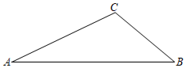

3. 如图，在 $\triangle ABC$ 中，$AB=2$，$\angle ACB=120^\circ$，则 $\triangle ABC$ 周长的最大值为 ___ ．

> [!question]- 点击查看答案与解析
> 【答案】$2+\frac{4\sqrt3}{3}$
> 
> 【考点】定弦定角隐圆、三角形周长最值 → [[【初中数学知识点体系-人教版】#29-1 圆的基本性质]]
> 
> 【解析】
> $AB=2$ 为定弦，$\angle ACB=120^\circ$ 为定角，$\triangle ABC$ 的外接圆半径 $R=\frac{AB}{2\sin120^\circ}=\frac{2}{\sqrt3}$。
> 由正弦定理，$AC+BC=2R(\sin A+\sin B)$，又 $A+B=180^\circ-120^\circ=60^\circ$。
> $\sin A+\sin B=2\sin\frac{A+B}{2}\cos\frac{A-B}{2}=\cos\frac{A-B}{2}\le 1$，当 $A=B=30^\circ$ 时取等号。
> 故周长最大值为 $AB+2R=2+\frac{4\sqrt3}{3}$。
> 
> 【易错点】周长最值拆为定边 $AB$ 加两动点边之和；和差化积后余弦取最大值 $1$ 时两底角相等。
