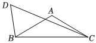
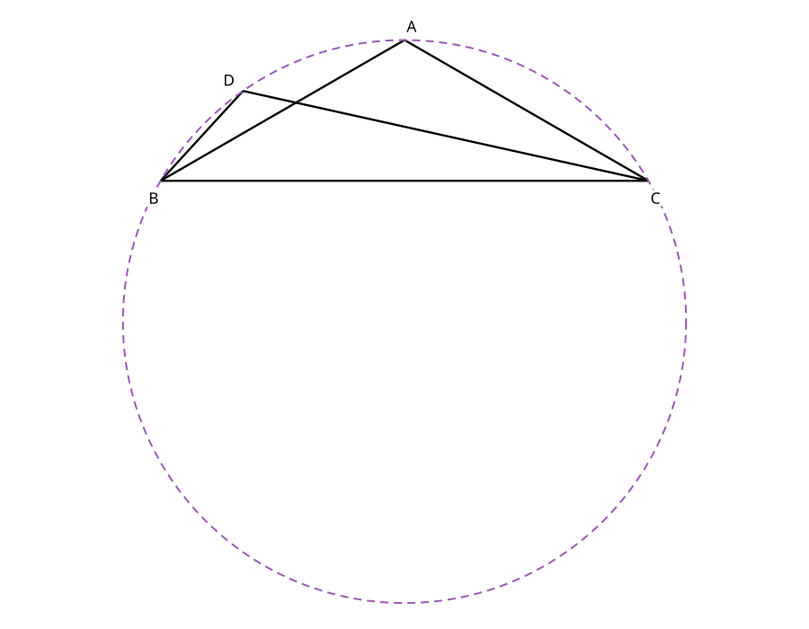

4. 如图，在 $\triangle ABC$ 中，$AB=AC=2$，$BC=2\sqrt{3}$，$D$ 是 $BC$ 上方平面内的一个动点，且 $\angle BDC=60^\circ$，则 $\triangle DBC$ 面积的最大值为 ___ ．

> [!question]- 点击查看答案与解析
> 【答案】$\sqrt3$
> 
> 【考点】定弦定角隐圆、三角形面积最值 → [[【初中数学知识点体系-人教版】#29-1 圆的基本性质]]
> 
> 【解析】
> $BC=2\sqrt3$ 为定弦，$\angle BDC=60^\circ$ 为定角，点 $D$ 所在隐圆半径 $R=\frac{BC}{2\sin60^\circ}=2$。
> 圆心在 $BC$ 的垂直平分线上，圆心到弦 $BC$ 的距离 $d=\sqrt{R^2-(BC/2)^2}=\sqrt{4-3}=1$。
> $D$ 在 $BC$ 上方，轨迹弧上的点到 $BC$ 的最大距离为 $R-d=1$。
> $S_{\triangle DBC}=\frac12\cdot BC\cdot h\le \frac12\times 2\sqrt3\times 1=\sqrt3$。
> 
> 
> 【易错点】区分两侧圆弧：上方动点对应的圆心在另一侧，最大高度为 $R-d$，不要误取 $R+d$。
