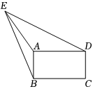
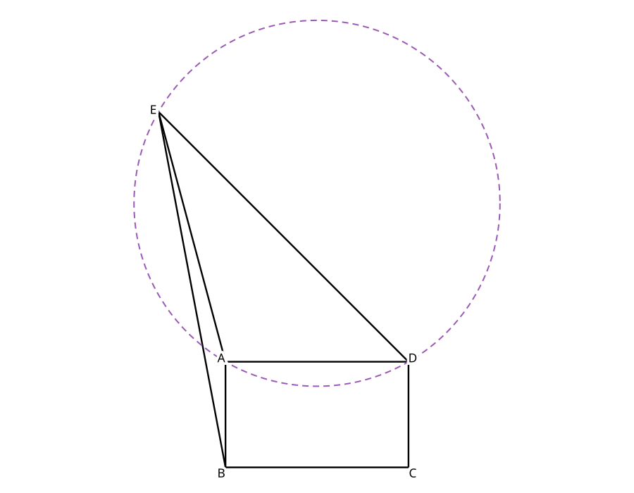

5. （2023•惠城区一模）如图，四边形 $ABCD$ 为矩形，$AB=2$，$AD=2\sqrt{3}$，$E$ 为平面内一点，且 $\angle AED=30^\circ$，连接 $BE$，则 $BE$ 的最大值是 ___ ．

> [!question]- 点击查看答案与解析
> 【答案】$2\sqrt7+2\sqrt3$
> 
> 【考点】定弦定角隐圆、点到圆的距离最大值 → [[【初中数学知识点体系-人教版】#29-1 圆的基本性质]]
> 
> 【解析】
> 矩形中 $AD=2\sqrt3$ 为定弦，$\angle AED=30^\circ$ 为定角，隐圆半径 $R=\frac{AD}{2\sin30^\circ}=2\sqrt3$，圆心在 $AD$ 的垂直平分线上，到 $AD$ 的距离为 $\sqrt{R^2-(AD/2)^2}=3$。
> 取离点 $B$ 较远一侧的圆心，求得圆心到 $B$ 的距离为 $2\sqrt7$。
> 点 $E$ 在该圆上运动，$BE$ 的最大值为圆心到 $B$ 的距离加上半径：$BE_{\max}=2\sqrt7+2\sqrt3$。
> 
> 
> 【易错点】定弦两侧各有一个轨迹圆，求最大值取离定点较远的圆；勿漏另一圆比较。
