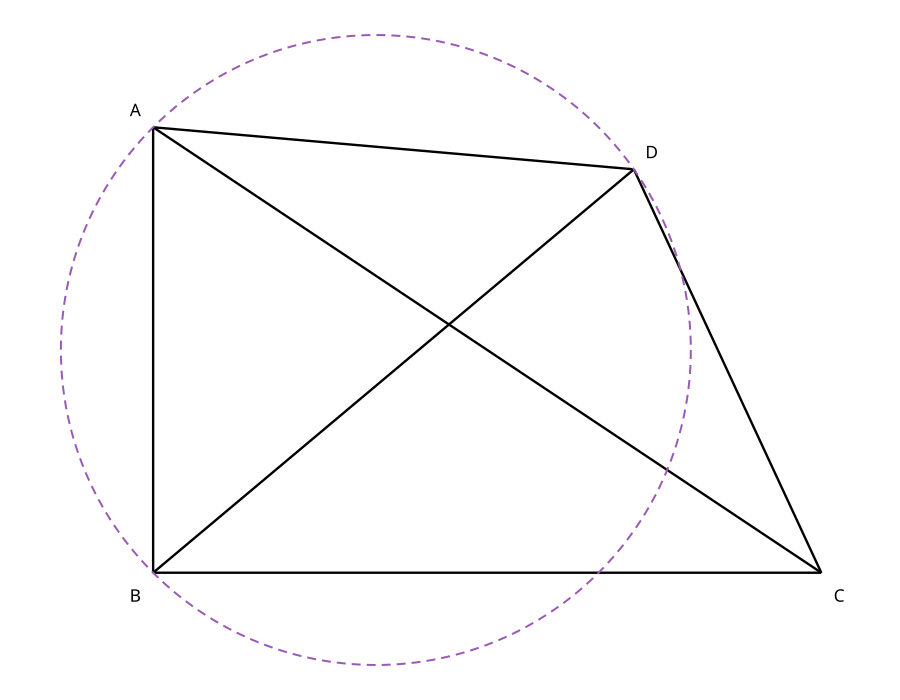

6. （2021•广东）在 $\triangle ABC$ 中，$\angle ABC=90^\circ$，$AB=2$，$BC=3$．点 $D$ 为平面上一个动点，$\angle ADB=45^\circ$，则线段 $CD$ 长度的最小值为 ___ ．

> [!question]- 点击查看答案与解析
> 【答案】$\sqrt5-\sqrt2$
> 
> 【考点】定弦定角隐圆、点到圆的距离最小值 → [[【初中数学知识点体系-人教版】#29-1 圆的基本性质]]
> 
> 【解析】
> $AB=2$ 为定弦，$\angle ADB=45^\circ$ 为定角，隐圆半径 $R=\frac{AB}{2\sin45^\circ}=\sqrt2$，圆心在 $AB$ 的垂直平分线上，到 $AB$ 的距离为 $\sqrt{R^2-1}=1$。
> 取离点 $C$ 较近一侧的圆心，求得圆心到 $C$ 的距离为 $\sqrt5$。
> 点 $D$ 在圆上，$CD$ 的最小值为圆心到 $C$ 的距离减去半径：$CD_{\min}=\sqrt5-\sqrt2$。
> 
> 
> 【易错点】求最小值用“圆心距 $-$ 半径”；先判断定点在圆外，再使用该公式。
