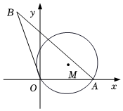
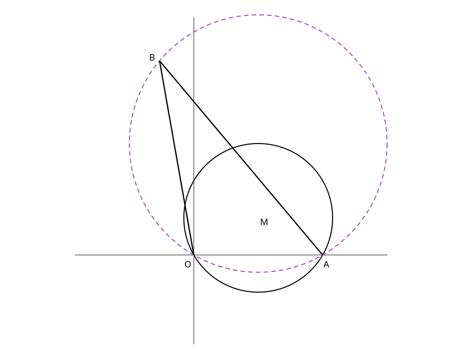

7. （2022•新吴区二模）如图，半径为 1 的 $\odot M$ 经过平面直角坐标系的原点 $O$，与 $x$ 轴交于点 $A$，点 $A$ 的坐标为（$\sqrt{3}$，0），点 $B$ 是直角坐标系平面内一动点，且 $\angle ABO=30^\circ$，则 $BM$ 的最大值为（　　）

A. $\sqrt{3}+1$

B. $\sqrt{3}+\frac{3}{2}$

C. $\sqrt{3}+2$

D. $\sqrt{3}+\frac{5}{2}$

> [!question]- 点击查看答案与解析
> 【答案】C
> 
> 【考点】定弦定角隐圆、坐标与点圆距离最值 → [[【初中数学知识点体系-人教版】#29-1 圆的基本性质]]、坐标方法的简单应用 → [[【初中数学知识点体系-人教版】#9-2 坐标方法的简单应用]]
> 
> 【解析】
> $\odot M$ 半径为 $1$，$O(0,0)$、$A(\sqrt3,0)$，故圆心 $M(\frac{\sqrt3}{2},\frac12)$。
> $\angle ABO=30^\circ$ 为定角，定弦为 $OA$，点 $B$ 的轨迹圆半径 $R=\frac{OA}{2\sin30^\circ}=\sqrt3$，圆心在 $OA$ 的垂直平分线 $x=\frac{\sqrt3}{2}$ 上。
> 取离 $M$ 较远一侧的圆心，圆心到 $M$ 的距离为 $2$，故 $BM_{\max}=2+\sqrt3$。
> - 选项A：$\sqrt3+1$，错误；
> - 选项B：$\sqrt3+\frac32$，错误；
> - 选项C：$\sqrt3+2$，正确；
> - 选项D：$\sqrt3+\frac52$，错误。
> 
> 
> 【易错点】先由已知圆确定 $M$ 的坐标，再由定弦定角求 $B$ 的轨迹圆；两侧圆心到 $M$ 距离不同，最大值取较远者。
