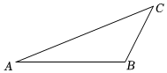

8. （2022•灞桥区校级模拟）在 $\triangle ABC$ 中，$AB=4$，$\angle C=45^\circ$，则 $\sqrt{2}AC+BC$ 的最大值为 ___ ．

> [!question]- 点击查看答案与解析
> 【答案】$4\sqrt{10}$
> 
> 【考点】定弦定角隐圆、加权边长最值（正弦型振幅） → [[【初中数学知识点体系-人教版】#29-1 圆的基本性质]]、锐角三角函数 → [[【初中数学知识点体系-人教版】#32-1 锐角三角函数]]
> 
> 【解析】
> $AB=4$，$\angle C=45^\circ$，外接圆直径 $2R=\frac{AB}{\sin45^\circ}=4\sqrt2$。
> 由正弦定理 $AC=2R\sin B$，$BC=2R\sin A$，且 $A+B=135^\circ$。
> $\sqrt2 AC+BC=2R(\sqrt2\sin B+\sin A)$，代入 $B=135^\circ-A$，化简得括号内为 $\cos A+2\sin A$，其振幅为 $\sqrt{1^2+2^2}=\sqrt5$。
> 最大值为 $2R\cdot\sqrt5=4\sqrt2\cdot\sqrt5=4\sqrt{10}$。
> 
> 【易错点】加权系数不同时，不能直接套用“两边之和最大”；须化为正弦型函数，用振幅 $\sqrt{a^2+b^2}$ 求最大值。
