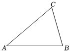

9. （2025•龙凤区二模）如图，在 $\triangle ABC$ 中，$AB=5\sqrt{2}$，$\tan\angle C=2$，则 $AC+\frac{\sqrt{5}}{5}BC$ 的最大值为 ___ ．

> [!question]- 点击查看答案与解析
> 【答案】$10$
> 
> 【考点】定弦定角隐圆、加权边长最值 → [[【初中数学知识点体系-人教版】#29-1 圆的基本性质]]、锐角三角函数 → [[【初中数学知识点体系-人教版】#32-1 锐角三角函数]]
> 
> 【解析】
> $\tan C=2$，故 $\sin C=\frac{2}{\sqrt5}$，外接圆直径 $2R=\frac{AB}{\sin C}=\frac{5\sqrt{10}}{2}$。
> $AC+\frac{\sqrt5}{5}BC=2R(\sin B+\frac{\sqrt5}{5}\sin A)$，化为关于 $A$ 的正弦型函数，振幅为 $\frac{2\sqrt{10}}{5}$。
> 最大值为 $2R\cdot$ 振幅 $=10$。
> 
> 【易错点】先由 $\tan C$ 求出 $\sin C$ 以确定外接圆直径；加权项合并后按振幅求最值。
