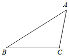

10. 如图，$\triangle ABC$ 中，$BC=6$，$\angle BAC=60^\circ$，则 $2AB+AC$ 的最大值是 ___ ．

> [!question]- 点击查看答案与解析
> 【答案】$4\sqrt{21}$
> 
> 【考点】定弦定角隐圆、加权边长最值 → [[【初中数学知识点体系-人教版】#29-1 圆的基本性质]]
> 
> 【解析】
> $BC=6$，$\angle BAC=60^\circ$，外接圆直径 $2R=\frac{6}{\sin60^\circ}=4\sqrt3$。
> $2AB+AC=2R(2\sin C+\sin B)$，$B=120^\circ-C$，化为正弦型函数后振幅为 $\sqrt7$。
> 最大值为 $2R\cdot\sqrt7=4\sqrt3\cdot\sqrt7=4\sqrt{21}$。
> 
> 【易错点】系数 $2$ 乘在 $AB$ 上，正弦对应系数不要写错；振幅按合并后的 $a\sin x+b\cos x$ 计算。
