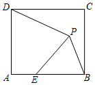
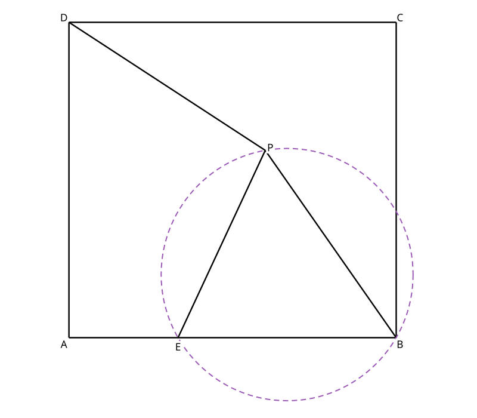

11. （2022•防城港模拟）如图，在矩形 $ABCD$ 中，$AD=5$，$AB=3\sqrt{3}$，点 $E$ 在 $AB$ 上，$\frac{AE}{EB}=\frac{1}{2}$，在矩形内找一点 $P$，使得 $\angle BPE=60^\circ$，则线段 $PD$ 的最小值为（　　）

A. $2\sqrt{7}-2$

B. $2\sqrt{13}-4$

C. 4

D. $2\sqrt{3}$

> [!question]- 点击查看答案与解析
> 【答案】A
> 
> 【考点】构造定弦定角轨迹圆、矩形内点圆距离最值 → [[【初中数学知识点体系-人教版】#29-1 圆的基本性质]]、特殊的平行四边形（矩形） → [[【初中数学知识点体系-人教版】#21-2 特殊的平行四边形]]
> 
> 【解析】
> 矩形 $AD=5$，$AB=3\sqrt3$，$\frac{AE}{EB}=\frac12$，故 $AE=\sqrt3$，$EB=2\sqrt3$。
> $\angle BPE=60^\circ$ 为定角，定弦为 $EB$，点 $P$ 的轨迹圆半径 $R=\frac{EB}{2\sin60^\circ}=2$，圆心在 $EB$ 的垂直平分线上。
> 求得圆心到 $D$ 的距离为 $2\sqrt7$，故 $PD_{\min}=2\sqrt7-2$。
> - 选项A：$2\sqrt7-2$，正确；
> - 选项B：$2\sqrt{13}-4$，错误；
> - 选项C：$4$，错误；
> - 选项D：$2\sqrt3$，错误。
> 
> 
> 【易错点】先按比例求出定弦 $EB$ 长度；轨迹圆在矩形内部的弧段才是 $P$ 的实际运动范围。
