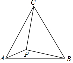
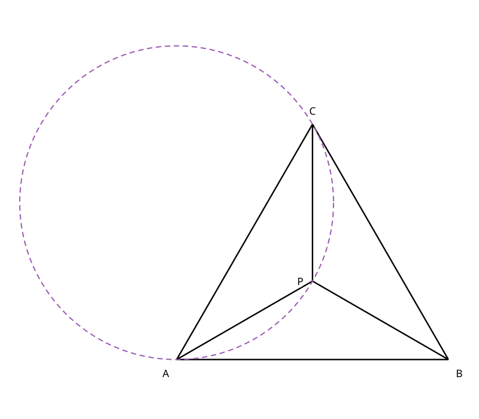

12. （2017•威海）如图，$\triangle ABC$ 为等边三角形，$AB=2$．若 $P$ 为 $\triangle ABC$ 内一动点，且满足 $\angle PAB=\angle ACP$，则线段 $PB$ 长度的最小值为 ___ ．

> [!question]- 点击查看答案与解析
> 【答案】$\frac{2\sqrt3}{3}$
> 
> 【考点】藏定角（等边三角形）轨迹圆、点圆距离最值 → [[【初中数学知识点体系-人教版】#29-1 圆的基本性质]]、等腰三角形 → [[【初中数学知识点体系-人教版】#15-3 等腰三角形]]
> 
> 【解析】
> 等边 $\triangle ABC$ 中 $\angle BAC=60^\circ$。由 $\angle PAB=\angle ACP$，得 $\angle PAC+\angle ACP=\angle PAC+\angle PAB=60^\circ$，故 $\angle APC=120^\circ$ 为定角。
> 定弦 $AC=2$，轨迹圆半径 $R=\frac{2}{2\sin120^\circ}=\frac{2\sqrt3}{3}$，圆心在 $AC$ 下方。
> 求得圆心到 $B$ 的距离为 $\frac{4\sqrt3}{3}$，故 $PB_{\min}=\frac{4\sqrt3}{3}-R=\frac{2\sqrt3}{3}$。
> 
> 
> 【易错点】隐藏定角要通过角的等量代换把 $\angle APC$ 凑成定值；$120^\circ$ 定角对应的圆心在弦的另一侧。
