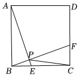
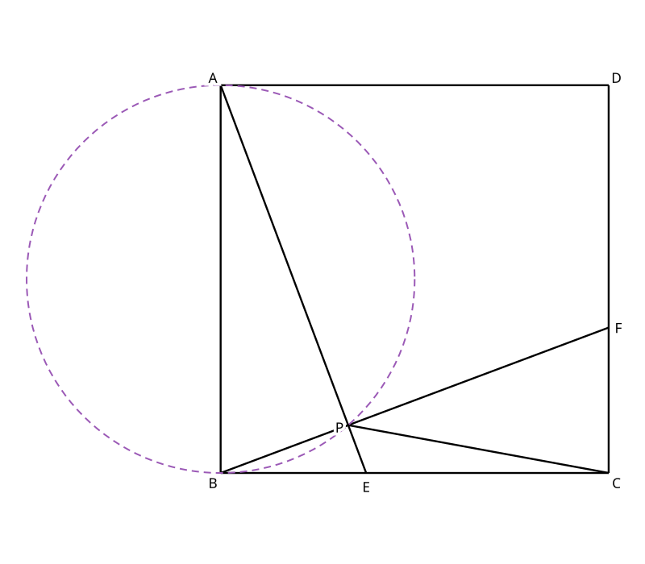

13. （2023秋•双台子区校级月考）如图，正方形 $ABCD$ 的边长为 4，点 $E$、$F$ 分别是 $BC$、$CD$ 上的动点，且 $BE=CF$，连接 $AE$、$BF$，两线段相交于点 $P$，连接 $CP$，则 $CP$ 的最小值是 ___ ．

> [!question]- 点击查看答案与解析
> 【答案】$2\sqrt5-2$
> 
> 【考点】正方形内藏定角、直径轨迹圆最值 → [[【初中数学知识点体系-人教版】#29-1 圆的基本性质]]、特殊的平行四边形（正方形） → [[【初中数学知识点体系-人教版】#21-2 特殊的平行四边形]]
> 
> 【解析】
> 正方形边长为 $4$，$BE=CF$，又 $AB=BC$，$\angle ABE=\angle BCF=90^\circ$，故 $\triangle ABE\cong\triangle BCF$。
> 得 $\angle BAE=\angle CBF$，从而 $\angle BAE+\angle ABF=\angle CBF+\angle ABF=90^\circ$，即 $AE\perp BF$，$\angle APB=90^\circ$ 为定角。
> 点 $P$ 在以 $AB$ 为直径的圆上，半径 $R=2$，圆心为 $AB$ 中点。
> 圆心到 $C$ 的距离为 $\sqrt{4^2+2^2}=2\sqrt5$，故 $CP_{\min}=2\sqrt5-2$。
> 
> 
> 【易错点】全等推出垂直关系后，$90^\circ$ 定角对应直径为定弦的圆；注意 $P$ 只在正方形内部的一段圆弧上。
