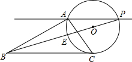
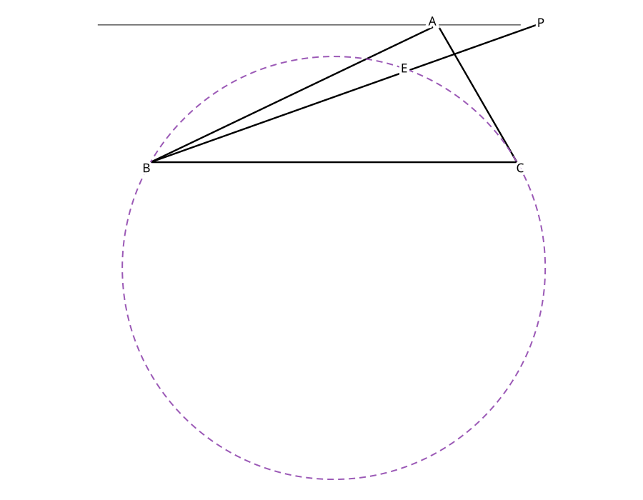

14. （2021•永嘉县校级模拟）如图，$\triangle ABC$，$AC=3$，$BC=4\sqrt{3}$，$\angle ACB=60^\circ$，过点 $A$ 作 $BC$ 的平行线 $l$，$P$ 为直线 $l$ 上一动点，$\odot O$ 为 $\triangle APC$ 的外接圆，直线 $BP$ 交 $\odot O$ 于 $E$ 点，则 $AE$ 的最小值为（　　）

A. $\sqrt{3}-1$

B. $7-4\sqrt{3}$

C. $\sqrt{3}$

D. 1

> [!question]- 点击查看答案与解析
> 【答案】D
> 
> 【考点】定角定圆轨迹、外接圆与点圆距离最值 → [[【初中数学知识点体系-人教版】#29-1 圆的基本性质]]、三角形外接圆与外心 → [[【初中数学知识点体系-人教版】#30-1 直线和圆的位置关系]]
> 
> 【解析】
> $AC=3$，$BC=4\sqrt3$，$\angle ACB=60^\circ$。$AP\parallel BC$，故 $\angle CAP=\angle ACB=60^\circ$。
> 在 $\triangle APC$ 的外接圆中，$\angle CEP=\angle CAP=60^\circ$（同弧 $CP$）；又 $E$、$P$、$B$ 共线，故 $\angle CEB=60^\circ$ 为定角。
> 定弦 $BC$ 所对圆周角为 $60^\circ$，点 $E$ 的轨迹是过 $B$、$C$ 的定圆，半径 $R=\frac{BC}{2\sin60^\circ}=4$，圆心在 $BC$ 下方。
> 求得圆心到 $A$ 的距离为 $5$，故 $AE_{\min}=5-4=1$。
> - 选项A：$\sqrt3-1$，错误；
> - 选项B：$7-4\sqrt3$，错误；
> - 选项C：$\sqrt3$，错误；
> - 选项D：$1$，正确。
> 
> 
> 【易错点】轨迹圆过定点 $B$、$C$ 而非 $A$；通过平行线和同弧所对圆周角把 $\angle CEB$ 凑成定值是关键。
