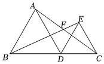
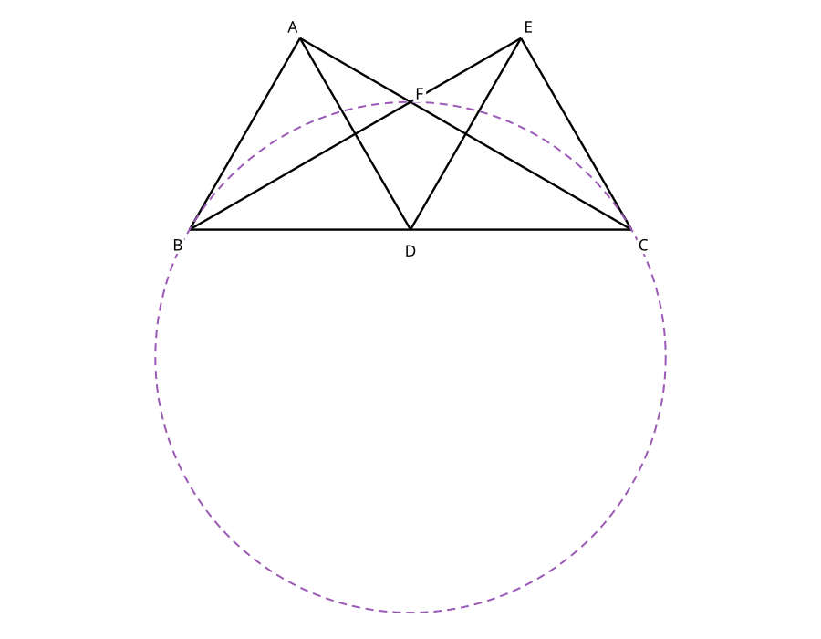

15. （2022•平乐县模拟）如图，点 $D$ 是线段 $BC$ 上的一个动点，分别以 $BD$、$CD$ 为边在 $BC$ 上方作等边 $\triangle ABD$ 和等边 $\triangle EDC$，连接 $AC$、$BE$ 相交于点 $F$．若 $BC=3$，当点 $D$ 从点 $B$ 运动到点 $C$ 时，点 $F$ 运动的路径长为 ___ ．

> [!question]- 点击查看答案与解析
> 【答案】$\frac{2\sqrt3\pi}{3}$
> 
> 【考点】旋转全等定角、交点轨迹弧长 → [[【初中数学知识点体系-人教版】#28-1 图形的旋转]]、弧长计算 → [[【初中数学知识点体系-人教版】#30-3 弧长和扇形面积]]
> 
> 【解析】
> 等边 $\triangle ABD$、$\triangle EDC$ 中，$AD=BD$，$DC=DE$，$\angle ADB=\angle EDC=60^\circ$，故 $\angle ADC=\angle BDE$，$\triangle ADC\cong\triangle BDE$（SAS）。
> 由此 $AC=BE$，且 $AC$ 与 $BE$ 的夹角为 $120^\circ$，即 $\angle BFC=120^\circ$ 为定角。
> 定弦 $BC=3$，点 $F$ 的轨迹圆半径 $R=\frac{BC}{2\sin120^\circ}=\sqrt3$，对应的圆心角为 $120^\circ$。
> 路径长为 $R\cdot\frac{2\pi}{3}=\frac{2\sqrt3\pi}{3}$。
> 
> 
> 【易错点】先由旋转全等证明定角，再算轨迹弧长；注意动点走的是圆弧，不要误算成弦长。
