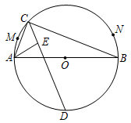
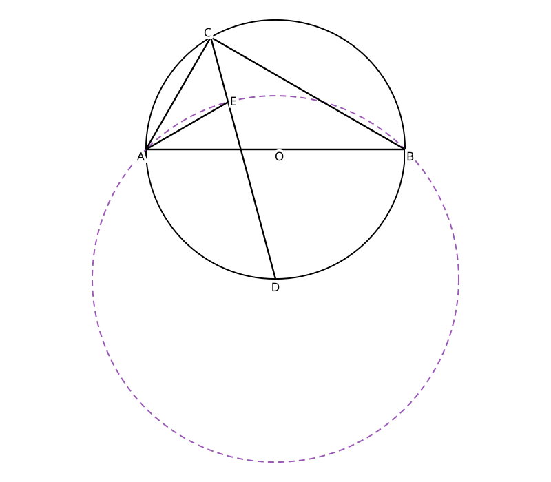

16. （2025•深圳模拟）如图，$AB$ 是 $\odot O$ 的直径，$M$、$N$ 是 $\widehat{AB}$（异于 $A$、$B$）上两点，$C$ 是 $\widehat{MN}$ 上一动点，$\angle ACB$ 的角平分线交 $\odot O$ 于点 $D$，$\angle BAC$ 的平分线交 $CD$ 于点 $E$．当点 $C$ 从点 $M$ 运动到点 $N$ 时，则 $C$、$E$ 两点的运动路径长的比是 ___ ．

> [!question]- 点击查看答案与解析
> 【答案】$C$ 的路径 $:E$ 的路径 $=\sqrt2:1$
> 
> 【考点】三角形内心轨迹、弧长比 → [[【初中数学知识点体系-人教版】#30-1 直线和圆的位置关系]]、弧长计算 → [[【初中数学知识点体系-人教版】#30-3 弧长和扇形面积]]
> 
> 【解析】
> $E$ 是 $\triangle ABC$ 两条角平分线的交点，即内心。$\angle AEB=90^\circ+\frac12\angle ACB=135^\circ$ 为定角。
> 定弦 $AB$ 固定，内心 $E$ 在以 $AB$ 为弦、所含圆周角 $135^\circ$ 的圆弧上运动；$C$ 在原 $\odot O$ 的一段弧上运动。
> 原圆半径为 $R$，$E$ 的轨迹圆半径为 $\sqrt2 R$；设 $C$ 走过的圆心角为 $2\Delta u$，则 $E$ 走过的圆心角为 $\Delta u$。故路径长之比 $C:E=(R\cdot2\Delta u):(\sqrt2 R\cdot\Delta u)=\sqrt2:1$。
> 
> 
> 【易错点】内心张角公式 $\angle AEB=90^\circ+\frac12\angle C$ 要记牢；同圆心角下弧长比等于半径比。
