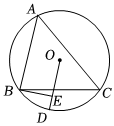
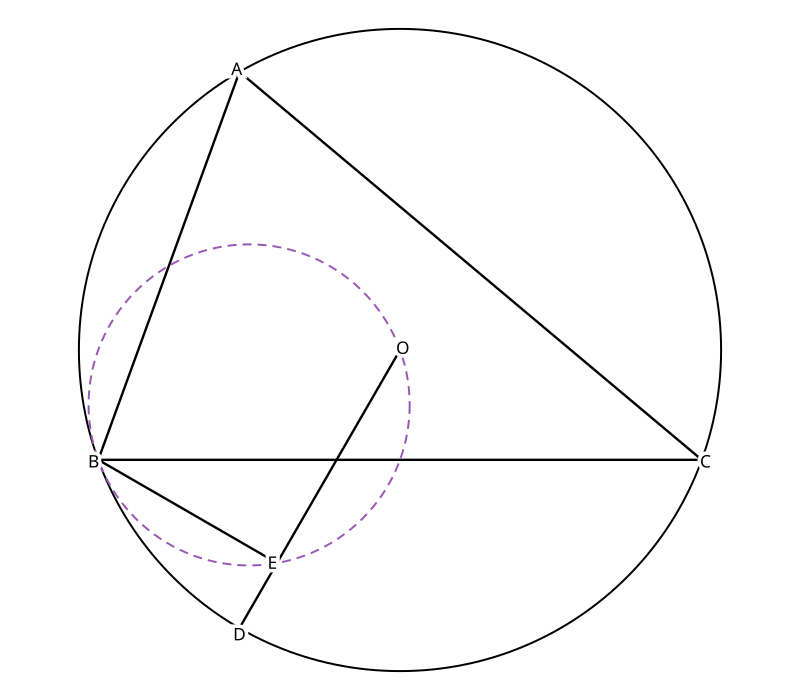

17. （2025春•武汉月考）如图，$\triangle ABC$ 内接于 $\odot O$，$BC=12$，$\angle A=60^\circ$，点 $D$ 为弧 $BC$ 上一动点，$BE\perp OD$ 于点 $E$，当 $D$ 从 $B$ 点沿弧 $BC$ 运动到点 $C$ 时，点 $E$ 经过的路径长为（　　）

A. 18

B. $4\sqrt{3}\pi$

C. $\frac{4\sqrt{3}}{3}\pi$

D. $\frac{8\sqrt{3}}{3}\pi$

> [!question]- 点击查看答案与解析
> 【答案】D
> 
> 【考点】藏定边（垂足轨迹圆）、弧长路径 → [[【初中数学知识点体系-人教版】#29-1 圆的基本性质]]、弧长计算 → [[【初中数学知识点体系-人教版】#30-3 弧长和扇形面积]]
> 
> 【解析】
> $\angle A=60^\circ$，$BC=12$，外接圆半径 $R=\frac{12}{2\sin60^\circ}=4\sqrt3$。
> $BE\perp OD$，故 $\angle OEB=90^\circ$ 为定角，点 $E$ 在以 $OB$ 为直径的圆上，半径为 $\frac R2=2\sqrt3$。
> $D$ 沿弧 $BC$ 运动，弧 $BC$ 所含圆心角为 $120^\circ$，对应 $E$ 轨迹圆上的圆心角为 $240^\circ$。
> 路径长 $=2\sqrt3\cdot\frac{4\pi}{3}=\frac{8\sqrt3\pi}{3}$。
> - 选项A：$18$，错误；
> - 选项B：$4\sqrt3\pi$，错误；
> - 选项C：$\frac{4\sqrt3}{3}\pi$，错误；
> - 选项D：$\frac{8\sqrt3}{3}\pi$，正确。
> 
> 
> 【易错点】垂足对定线段 $OB$ 张直角，轨迹是以 $OB$ 为直径的圆；轨迹圆心角是原圆心角的两倍，勿照搬 $120^\circ$。
