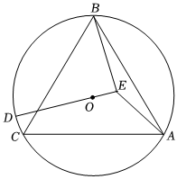
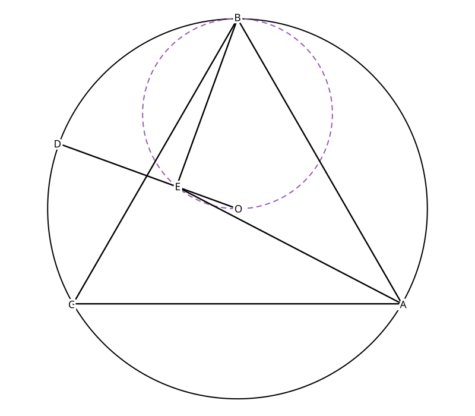

18. （2024秋•荔湾区期末）如图，等边 $\triangle ABC$ 内接于 $\odot O$，$BC=12\sqrt{3}$，点 $D$ 为 $\widehat{BC}$ 上一动点，$BE\perp OD$ 于点 $E$，当点 $D$ 由点 $B$ 沿 $\widehat{BC}$ 运动到点 $C$ 时，线段 $AE$ 的最大值是 ___ ．

> [!question]- 点击查看答案与解析
> 【答案】$6\sqrt7+6$
> 
> 【考点】藏定边垂足轨迹圆、点圆距离最大值 → [[【初中数学知识点体系-人教版】#29-1 圆的基本性质]]
> 
> 【解析】
> 等边 $\triangle ABC$ 内接于 $\odot O$，$BC=12\sqrt3$，外接圆半径 $R=\frac{12\sqrt3}{2\sin60^\circ}=12$。
> $BE\perp OD$，$\angle OEB=90^\circ$，点 $E$ 在以 $OB$ 为直径的圆上，半径为 $6$。
> 求得该小圆圆心到点 $A$ 的距离为 $6\sqrt7$，故 $AE_{\max}=6\sqrt7+6$。
> 
> 
> 【易错点】最大值为“圆心距 $+$ 半径”；先由等边三角形求出外接圆半径，再确定小轨迹圆半径。
