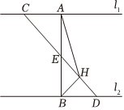
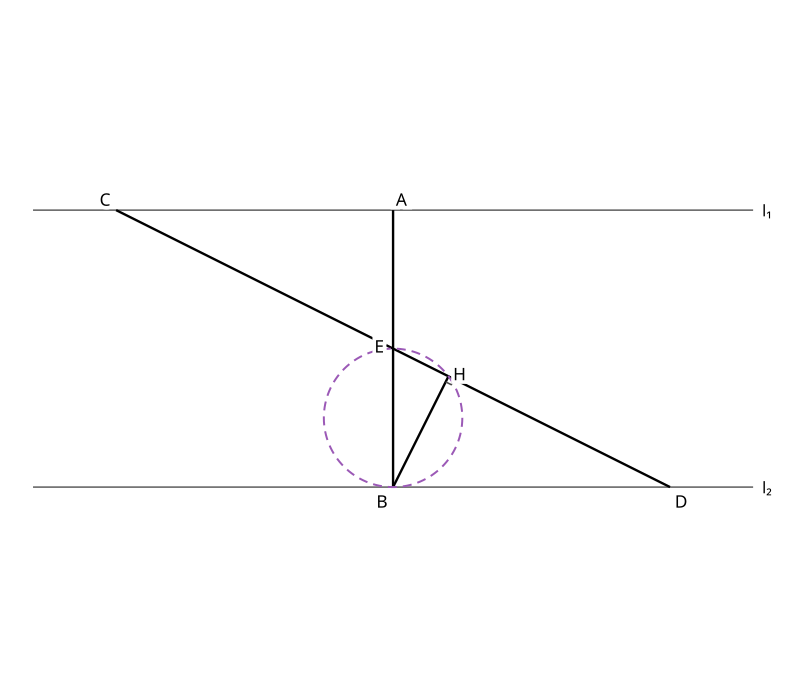

19. （2024•扬州）如图，已知两条平行线 $l_{1}$、$l_{2}$，点 $A$ 是 $l_{1}$ 上的定点，$AB\perp l_{2}$ 于点 $B$，点 $C$、$D$ 分别是 $l_{1}$，$l_{2}$ 上的动点，且满足 $AC=BD$，连接 $CD$ 交线段 $AB$ 于点 $E$，$BH\perp CD$ 于点 $H$，则当 $\angle BAH$ 最大时，$\sin\angle BAH$ 的值为 ___ ．

> [!question]- 点击查看答案与解析
> 【答案】$\frac13$
> 
> 【考点】平行线等线段构造、定角最值与锐角三角函数 → [[【初中数学知识点体系-人教版】#32-1 锐角三角函数]]、定弦定角隐圆 → [[【初中数学知识点体系-人教版】#29-1 圆的基本性质]]
> 
> 【解析】
> 由 $AC=BD$ 且 $l_1\parallel l_2$、$AB\perp l_2$，可证 $E$ 为 $AB$ 的中点，即动直线 $CD$ 绕定点 $E$ 旋转。$BH\perp CD$，故 $\angle BHE=90^\circ$，点 $H$ 在以 $BE$ 为直径的圆上。
> 设 $AB=h$，该圆圆心为 $O$，则半径 $r=\frac h4$，$AO=h-\frac h4=\frac{3h}{4}$。当 $AH$ 与该圆相切时 $\angle BAH$ 最大，此时 $\sin\angle BAH=\frac{r}{AO}=\frac{1}{3}$。
> 
> 
> 【易错点】最大张角对应直线与轨迹圆相切；轨迹圆直径是 $BE$ 而非 $AB$，正弦值等于半径与定点到圆心距离之比。
