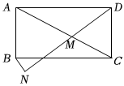
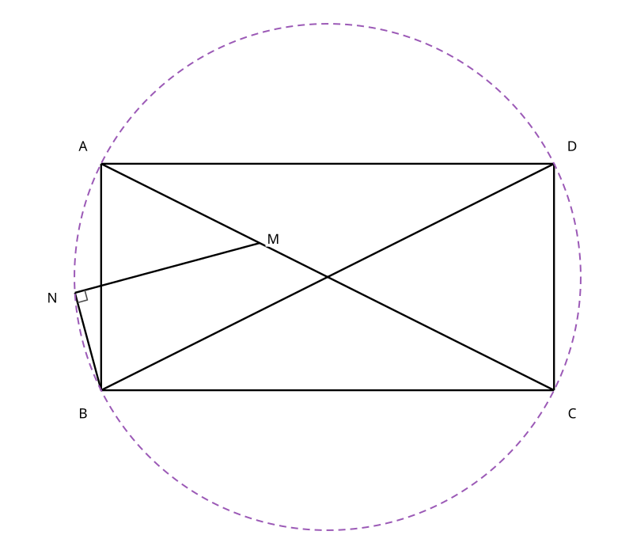

20. （2026•成华区模拟）如图，在矩形 $ABCD$ 中，$AD=2AB$，$M$ 为对角线 $AC$ 上一动点，过点 $B$ 作直线 $DM$ 的垂线，垂足为点 $N$，则 $\frac{NM}{DM}$ 的最大值是 ___ ．

> [!question]- 点击查看答案与解析
> 【答案】$\frac54$
> 
> 【考点】矩形内垂足轨迹圆、线段比值最值 → [[【初中数学知识点体系-人教版】#21-2 特殊的平行四边形]]、定弦定角隐圆 → [[【初中数学知识点体系-人教版】#29-1 圆的基本性质]]
> 
> 【解析】
> 设 $AB=a$，则 $AD=2a$。$BN\perp DM$，故 $\angle BND=90^\circ$，点 $N$ 在以 $BD$ 为直径的圆上。
> 设 $M$ 在 $AC$ 上的位置参数为 $s$，由相似与勾股把 $\frac{NM}{DM}$ 表示为 $r(s)=\frac{5s(1-s)}{5s^2-8s+4}$。
> 求导得极值点 $s=\frac23$（另一根 $s=2$ 舍去），代入得 $r_{\max}=\frac54$。
> 
> 
> 【易错点】垂足对定线段 $BD$ 张直角，轨迹为直径圆；比值最值先建参数函数再求极值，注意参数范围 $0<s<1$。
