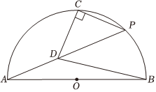
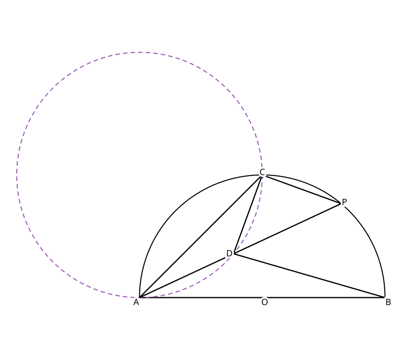

21. （2024秋•阎良区校级期末）如图，$AB$ 是半圆 $O$ 的直径，点 $C$ 为 $\widehat{AB}$ 的中点，点 $P$ 为 $\widehat{BC}$ 上任意一点，连接 $AP$，$CP$，过点 $C$ 作 $CD\perp CP$ 交 $AP$ 于 $D$，连接 $BD$，若 $AB=6$，则 $BD$ 的最小值为 ___ ．

> [!question]- 点击查看答案与解析
> 【答案】$3\sqrt5-3$
> 
> 【考点】藏定边定角轨迹圆、点圆距离最小值 → [[【初中数学知识点体系-人教版】#29-1 圆的基本性质]]
> 
> 【解析】
> $AB=6$ 为半圆直径，$C$ 为弧 $AB$ 中点，故 $\angle CBA=\angle CAB=45^\circ$。
> $CD\perp CP$，即 $\angle PCD=90^\circ$；结合圆周角关系可证点 $D$ 对定线段张定角，其轨迹是半径为 $3$ 的圆，圆心到 $B$ 的距离为 $3\sqrt5$。
> 故 $BD_{\min}=3\sqrt5-3$。
> 
> 
> 【易错点】由垂直条件和圆周角推出定角后再找轨迹圆；最小值为圆心距减半径。
