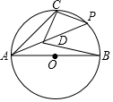
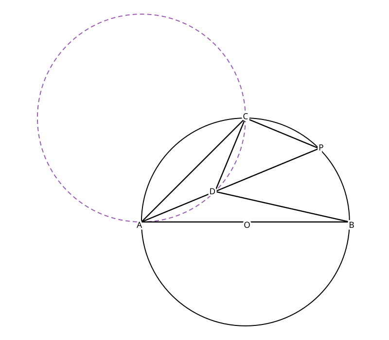

22. （2018•无锡模拟）如图，$\odot O$ 的直径 $AB=8$，$C$ 为 $\widehat{AB}$ 的中点，$P$ 为 $\odot O$ 上一动点，连接 $AP$、$CP$，过 $C$ 作 $CD\perp CP$ 交 $AP$ 于点 $D$，点 $P$ 从 $B$ 运动到 $C$ 时，则点 $D$ 运动的路径长为 ___ ．

> [!question]- 点击查看答案与解析
> 【答案】$2\pi$
> 
> 【考点】藏定边定角轨迹圆、弧长路径 → [[【初中数学知识点体系-人教版】#29-1 圆的基本性质]]、弧长计算 → [[【初中数学知识点体系-人教版】#30-3 弧长和扇形面积]]
> 
> 【解析】
> $AB=8$，$C$ 为弧 $AB$ 中点，模型与第 21 题相同；点 $D$ 的轨迹圆半径为 $4$，圆心在左上方。
> $P$ 从 $B$ 运动到 $C$，点 $D$ 沿轨迹圆走过 $90^\circ$ 弧。
> 路径长 $=4\cdot\frac{\pi}{2}=2\pi$。
> 
> 
> 【易错点】同一构型半径随原圆半径缩放；先确定轨迹圆心角再乘半径算弧长。
