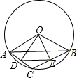
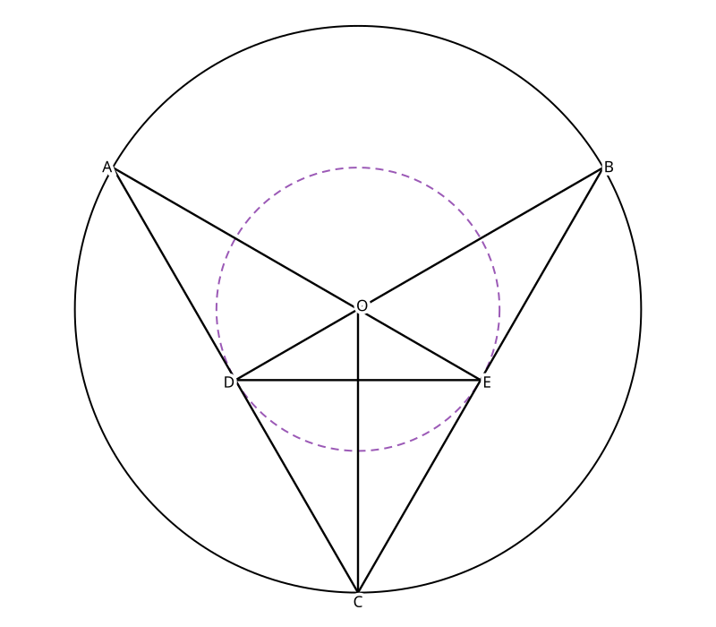

23. （2020•长沙）如图，半径为 4 的 $\odot O$ 中，弦 $AB$ 的长度为 $4\sqrt{3}$，点 $C$ 是劣弧 $\widehat{AB}$ 上的一个动点，点 $D$ 是弦 $AC$ 的中点，点 $E$ 是弦 $BC$ 的中点，连接 $DE$、$OD$、$OE$．

（1）求 $\angle AOB$ 的度数；

（2）当点 $C$ 沿着劣弧 $\widehat{AB}$ 从点 $A$ 开始，逆时针运动到点 $B$ 时，求 $\triangle ODE$ 的外心 $P$ 所经过的路径的长度；

（3）分别记 $\triangle ODE$，$\triangle CDE$ 的面积为 $S_{1}$，$S_{2}$，当 $S_{1}^{2}-S_{2}^{2}=21$ 时，求弦 $AC$ 的长度．

> [!question]- 点击查看答案与解析
> 【答案】（1）$120^\circ$；（2）$\frac{4\pi}{3}$；（3）$AC=\sqrt{15}+\sqrt3$ 或 $\sqrt{15}-\sqrt3$
> 
> 【考点】弦心距与圆心角、三角形外心轨迹、面积与弦长计算 → [[【初中数学知识点体系-人教版】#30-1 直线和圆的位置关系]]、圆的基本性质 → [[【初中数学知识点体系-人教版】#29-1 圆的基本性质]]、弧长计算 → [[【初中数学知识点体系-人教版】#30-3 弧长和扇形面积]]
> 
> 【解析】
> （1）半径 $R=4$，$AB=4\sqrt3$，由弦长公式 $AB=2R\sin\frac{\angle AOB}{2}$，得 $\sin\frac{\angle AOB}{2}=\frac{\sqrt3}{2}$，故 $\angle AOB=120^\circ$。
> （2）$D$、$E$ 分别为 $AC$、$BC$ 中点，$OD\perp AC$，$OE\perp BC$。$\triangle ODE$ 的外心 $P$ 到 $O$、$D$、$E$ 等距，轨迹是以 $O$ 为圆心、半径 $2$ 的一段圆弧；对应圆心角 $120^\circ$，路径长 $=2\cdot\frac{2\pi}{3}=\frac{4\pi}{3}$。
> （3）设 $\angle AOC=2\alpha$，$\angle BOC=2\beta$，$\alpha+\beta=120^\circ$。$S_1=4\sqrt3\cos\alpha\cos\beta$，$S_2=4\sqrt3\sin\alpha\sin\beta$，故 $S_1^2-S_2^2=48\cos(\alpha+\beta)\cos(\alpha-\beta)=-24\cos(\alpha-\beta)=21$，得 $\cos(\alpha-\beta)=-\frac78$。
> $AC=8\sin\alpha$，解得 $AC=\sqrt{15}\pm\sqrt3$。
> 
> 
> 【易错点】外心轨迹圆心不要误判为 $DE$ 中点；面积差用积化和差化简，注意 $\alpha-\beta$ 有正负两解。
