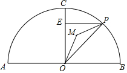
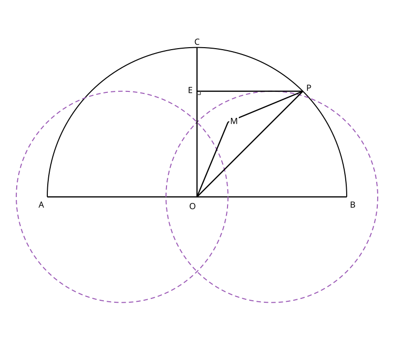

24. （2020•浙江自主招生）如图，$AB$ 为 $\odot O$ 的直径，且 $AB=4$，点 $C$ 在半圆上，$OC\perp AB$，垂足为点 $O$，$P$ 为半圆上任意一点，过 $P$ 点作 $PE\perp OC$ 于点 $E$，设 $\triangle OPE$ 的内心为 $M$，连接 $OM$、$PM$．当点 $P$ 在半圆上从点 $B$ 运动到点 $A$ 时，内心 $M$ 所经过的路径长为 ___ ．

> [!question]- 点击查看答案与解析
> 【答案】$\sqrt2\pi$
> 
> 【考点】直角三角形内心轨迹、两段圆弧路径 → [[【初中数学知识点体系-人教版】#30-1 直线和圆的位置关系]]、弧长计算 → [[【初中数学知识点体系-人教版】#30-3 弧长和扇形面积]]
> 
> 【解析】
> $AB=4$ 为直径，$OC\perp AB$，$\triangle OPE$ 为直角三角形（$PE\perp OC$），$M$ 为其内心。
> 内心对斜边 $OP$ 的张角 $\angle OMP=90^\circ+\frac12\angle OEP=135^\circ$ 为定值，故 $M$ 的轨迹是左右两段 $90^\circ$ 弧所在的两个圆，半径为 $\sqrt2$。
> 两段弧圆心角合计 $180^\circ$，路径长 $=\sqrt2\cdot\pi=\sqrt2\pi$。
> 
> 
> 【易错点】内心张角公式与定弦定角结合判断轨迹；$P$ 从 $B$ 到 $A$ 轨迹分左右两段，不要只算一段。
