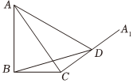
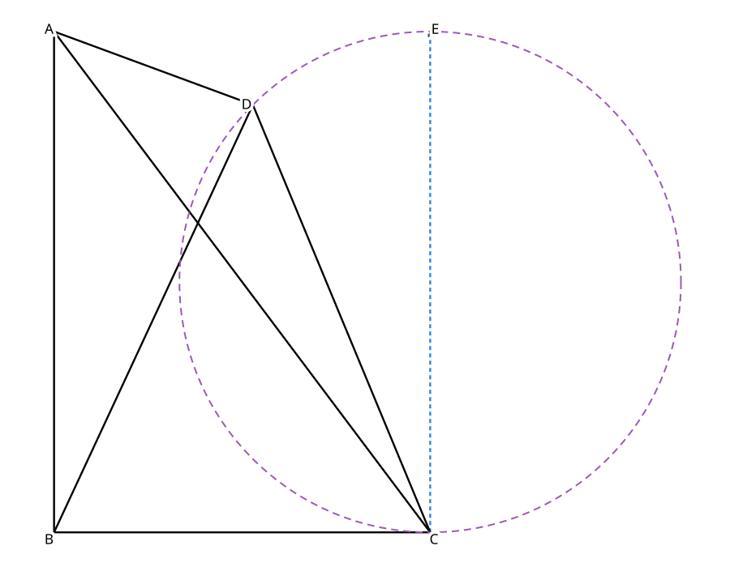

25. （2025•宜宾）如图，在 Rt$\triangle ABC$ 中，$\angle ABC=90^\circ$，$BC=6$，将射线 $CA$ 绕点 $C$ 顺时针旋转 $90^\circ$ 到 $CA_{1}$，在射线 $CA_{1}$ 上取一点 $D$，连结 $AD$，使得 $\triangle ACD$ 面积为 24，连结 $BD$，则 $BD$ 的最大值是 ___ ．

> [!question]- 点击查看答案与解析
> 【答案】$4+2\sqrt{13}$
> 
> 【考点】旋转相似构造、隐圆上点到点距离最大值 → [[【初中数学知识点体系-人教版】#31-2 相似三角形]]、定弦定角隐圆 → [[【初中数学知识点体系-人教版】#29-1 圆的基本性质]]
> 
> 【解析】
> 在 Rt$\triangle ABC$ 中 $\angle ABC=90^\circ$，$BC=6$。射线 $CA$ 绕 $C$ 顺时针旋转 $90^\circ$ 到 $CA_1$。
> 作 $CE\perp BC$ 使 $CE=8$（由 $AC\cdot CD=48=BC\cdot CE$ 得比例关系），可证 $\triangle CED\sim\triangle CAB$，从而 $\angle EDC=90^\circ$。
> 点 $D$ 在以 $CE$ 为直径的圆上运动；求得该圆圆心到 $B$ 的距离为 $2\sqrt{13}$，半径为 $4$，故 $BD_{\max}=4+2\sqrt{13}$。
> 
> 
> 【易错点】题干未直接给出 $AB$，需用面积条件与相似比例定出构造线段；最大值为圆心距加半径。
