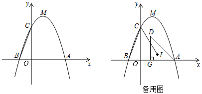
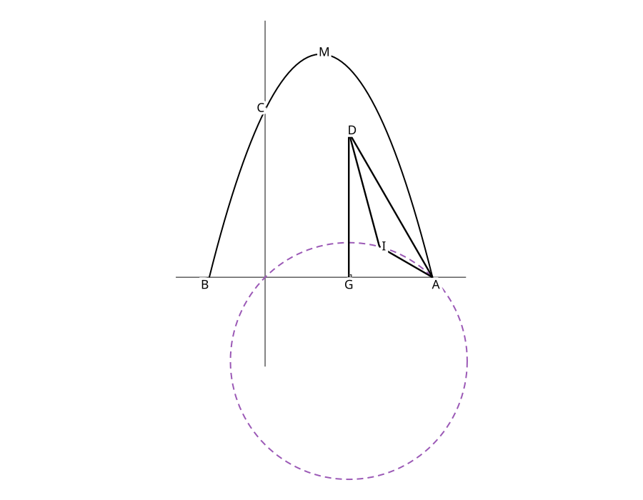

26. （2019•淄博）如图，顶点为 $M$ 的抛物线 $y=ax^{2}+bx+3$ 与 $x$ 轴交于 $A$（3，0），$B$（-1，0）两点，与 $y$ 轴交于点 $C$．

（1）求这条抛物线对应的函数表达式；

（2）问在 $y$ 轴上是否存在一点 $P$，使得 $\triangle PAM$ 为直角三角形？若存在，求出点 $P$ 的坐标；若不存在，说明理由．

（3）若在第一象限的抛物线下方有一动点 $D$，满足 $DA=OA$，过 $D$ 作 $DG\perp x$ 轴于点 $G$，设 $\triangle ADG$ 的内心为 $I$，试求 $CI$ 的最小值．

> [!question]- 点击查看答案与解析
> 【答案】（1）$y=-x^2+2x+3$；（2）$P(0,-\frac32)$、$(0,\frac{19}{8})$、$(0,1)$、$(0,3)$；（3）$\frac{3\sqrt{10}-3\sqrt2}{2}$
> 
> 【考点】待定系数求抛物线、直角三角形分类讨论、内心轨迹圆最值 → [[【初中数学知识点体系-人教版】#26-1 二次函数的图象与性质]]、二次函数与一元二次方程 → [[【初中数学知识点体系-人教版】#26-2 二次函数与一元二次方程]]、三角形内切圆与内心 → [[【初中数学知识点体系-人教版】#30-1 直线和圆的位置关系]]
> 
> 【解析】
> （1）抛物线 $y=ax^2+bx+3$ 过 $A(3,0)$、$B(-1,0)$，代入解得 $a=-1$，$b=2$，故 $y=-x^2+2x+3$，顶点 $M(1,4)$，$C(0,3)$。
> （2）设 $P(0,t)$，分 $\angle PAM=90^\circ$、$\angle APM=90^\circ$、$\angle AMP=90^\circ$ 三种情况用勾股定理列方程，解得 $t=-\frac32$、$\frac{19}{8}$、$1$、$3$，即四个 $P$ 点。
> （3）设内心 $I(m,n)$，由切线长关系得 $DG=m+n$，$AG=n+3-m$，结合 $DG^2+AG^2=DA^2=9$，化简配方得 $(m-\frac32)^2+(n+\frac32)^2=\frac92$。
> 即 $I$ 在以 $Q(\frac32,-\frac32)$ 为圆心、半径 $\frac{3\sqrt2}{2}$ 的第一象限圆弧上；$CQ=\frac{3\sqrt{10}}{2}$，故 $CI_{\min}=CQ-IQ=\frac{3\sqrt{10}-3\sqrt2}{2}$。
> 
> 
> 【易错点】直角三角形直角顶点必须分三类讨论；内心轨迹方程用切线长（$IE=IF=IH$）推导，配方后注意只取第一象限弧段。
