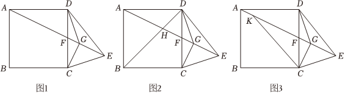
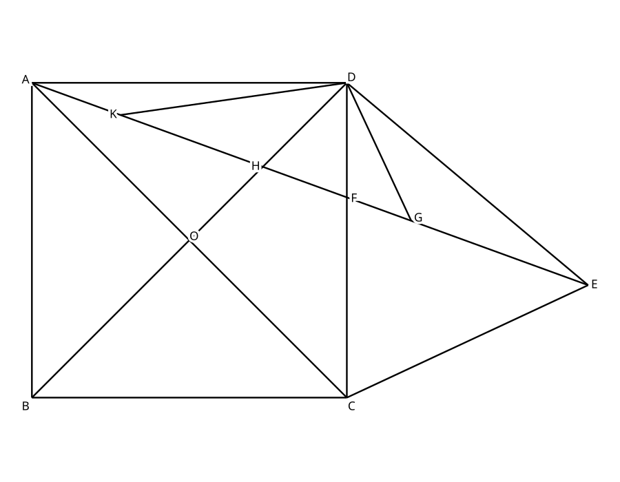

27. （2026•武汉）将正方形 $ABCD$ 的边 $CD$ 绕点 $D$ 逆时针旋转得到 $DE$，连接 $AE$ 交边 $CD$ 于点 $F$，$DG$ 平分 $\angle CDE$ 交 $AE$ 于点 $G$，连接 $CG$、$CE$．

（1）如图1，求证：$\triangle CGE$ 是等腰直角三角形（温馨提示：若思考有困难，可尝试证明 $\angle DAE=\angle DEG=\angle DCG$）．

（2）如图2，连接 $BD$ 交 $AE$ 于点 $H$，求证：$AF\cdot AE=2AH\cdot AG$．

（3）如图3，点 $K$ 在线段 $AE$ 上，$AK=\frac{1}{2}CG$，连接 $CK$．若 $AB=4$，直接写出 $CK$ 的最小值．

> [!question]- 点击查看答案与解析
> 【答案】（1）（2）证明见解析；（3）$\sqrt{34}-\sqrt2$
> 
> 【考点】正方形旋转、全等与相似判定、构造相似轨迹圆最值 → [[【初中数学知识点体系-人教版】#28-1 图形的旋转]]、三角形全等的判定 → [[【初中数学知识点体系-人教版】#14-2 三角形全等的判定]]、相似三角形 → [[【初中数学知识点体系-人教版】#31-2 相似三角形]]、定弦定角隐圆 → [[【初中数学知识点体系-人教版】#29-1 圆的基本性质]]
> 
> 【解析】
> （1）$DE=DC=DA$，$DG$ 平分 $\angle CDE$，故 $\triangle DGE\cong\triangle DGC$（SAS），$GE=GC$，$\angle DEG=\angle DCG$。又 $\triangle ADE$ 等腰，$\angle DAE=\angle DEG$，结合角度计算可得 $\angle GCE=\angle GEC=45^\circ$，故 $\triangle CGE$ 为等腰直角三角形。
> （2）连接 $AC$，交 $BD$ 于点 $O$。正方形对角线互相垂直，故 $\angle AOH=90^\circ$；由（1）知 $\angle AGC=90^\circ$。又 $\angle OAH=\angle GAC$，故 $\triangle AOH\sim\triangle AGC$，得 $\frac{AO}{AG}=\frac{AH}{AC}$，即 $AG\cdot AH=AO\cdot AC=2AO^2$。又 $\angle ACF=\angle ACD=45^\circ=\angle AEC$，$\angle CAF=\angle EAC$，故 $\triangle ACF\sim\triangle AEC$，得 $\frac{AC}{AE}=\frac{AF}{AC}$，即 $AF\cdot AE=AC^2=4AO^2$。所以 $AF\cdot AE=2AH\cdot AG$。
> （3）$AB=4$。在 $AE$ 上取点 $M$ 使 $AK=KM$，则 $AM=2AK=CG$。由 $AD=CD$，$\angle DAM=\angle DCG$，得 $\triangle ADM\cong\triangle CDG$，故 $\angle AMD=\angle CGD=135^\circ$ 为定值，点 $M$ 在以 $AD$ 为弦、所含圆周角 $135^\circ$ 的圆上，半径为 $2\sqrt2$。$K$ 为 $AM$ 中点，以 $A$ 为位似中心、位似比为 $\frac12$，点 $K$ 的轨迹圆半径为 $\sqrt2$。求得该圆圆心到 $C$ 的距离为 $\sqrt{34}$，故 $CK_{\min}=\sqrt{34}-\sqrt2$。
> 
> 
> 【易错点】第（3）问用“半长加半腰”构造相似三角形定出轨迹圆；注意 $K$ 在线段 $AE$ 上，轨迹只是圆的一部分弧。
