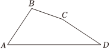
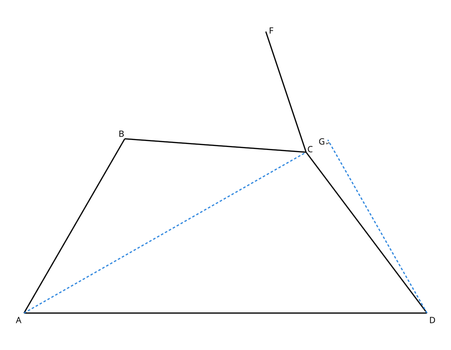

28. （2023秋•越秀区期末）如图，四边形 $ABCD$ 中，$AB=CD$，$\angle ABC+\angle BCD=270^\circ$．

（1）求 $\angle A+\angle D$ 的度数；

（2）连接 $AC$，若 $\angle ACB=45^\circ$，求证：$BC^{2}+2AC^{2}=AD^{2}$；

（3）点 $E$，$F$ 分别为线段 $BC$ 和 $AD$ 上的点，点 $G$ 是线段 $EF$ 上任意一点，且 $\triangle GAB$ 和 $\triangle GCD$ 的面积相等，过点 $D$ 作 $DH\perp EF$，$DH$ 交直线 $EF$ 于点 $H$，连接 $AH$．若 $AD=4$，求线段 $AH$ 的最小值．

> [!question]- 点击查看答案与解析
> 【答案】（1）$90^\circ$；（2）证明见解析；（3）$\sqrt{10}-\sqrt2$
> 
> 【考点】四边形内角和、全等构造证明、角平分线与隐圆轨迹最值 → [[【初中数学知识点体系-人教版】#14-2 三角形全等的判定]]、定弦定角隐圆 → [[【初中数学知识点体系-人教版】#29-1 圆的基本性质]]、相似三角形 → [[【初中数学知识点体系-人教版】#31-2 相似三角形]]
> 
> 【解析】
> （1）四边形内角和为 $360^\circ$，$\angle A+\angle D=360^\circ-(\angle ABC+\angle BCD)=90^\circ$。
> （2）作 $DG\perp AC$ 交 $AC$ 延长线于 $G$，在 $DG$ 延长线上截取 $DF=AC$，连接 $CF$。由角的关系得 $\angle CDF=\angle BAC$，又 $AB=CD$，故 $\triangle ABC\cong\triangle DCF$（SAS），$CF=BC$，$\angle F=\angle ACB=45^\circ$，$CG=FG=\frac{\sqrt2}{2}BC$。在 Rt$\triangle AGD$ 中由勾股定理整理得 $BC^2+2AC^2=AD^2$。
> （3）延长 $AB$、$DC$ 交于 $X$，由（1）得 $\angle AXD=90^\circ$。$[GAB]=[GCD]$ 且 $AB=CD$，故 $G$ 到两直线距离相等，$G$ 在 $\angle AXD$ 的平分线上，即 $EF$ 为该角平分线。设 $EF$ 交以 $AD$ 为直径的圆于 $W$，$W$ 为半圆弧中点，$DW=2\sqrt2$。$DH\perp EF$，$\angle DHW=90^\circ$，故 $H$ 在以 $DW$ 为直径的圆上，半径为 $\sqrt2$。求得该圆圆心到 $A$ 的距离为 $\sqrt{10}$，故 $AH_{\min}=\sqrt{10}-\sqrt2$。
> 
> 
> 【易错点】面积相等等价于到两定直线距离相等，对应角平分线；第（2）问辅助线是截长构造全等，勿把 $DF$ 错取在 $DG$ 上。
