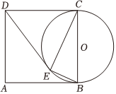
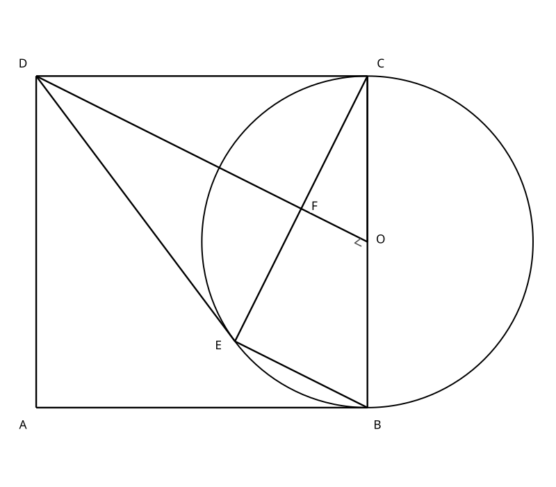

29. （2022秋•越秀区期末）如图，$ABCD$ 是正方形，$BC$ 是 $\odot O$ 的直径，点 $E$ 是 $\odot O$ 上的一动点（点 $E$ 不与点 $B$，$C$ 重合），连接 $DE$，$BE$，$CE$．

（1）若 $\angle EBC=60^\circ$，求 $\angle ECB$ 的度数；

（2）若 $DE$ 为 $\odot O$ 的切线，连接 $DO$，$DO$ 交 $CE$ 于点 $F$，求证：$DF=CE$；

（3）若 $AB=2$，过点 $A$ 作 $DE$ 的垂线交射线 $CE$ 于点 $M$，求 $AM$ 的最小值．

> [!question]- 点击查看答案与解析
> 【答案】（1）$30^\circ$；（2）证明见解析；（3）$\sqrt5-1$
> 
> 【考点】直径所对圆周角、切线性质、轨迹圆最值 → [[【初中数学知识点体系-人教版】#29-1 圆的基本性质]]、切线的判定与性质 → [[【初中数学知识点体系-人教版】#30-1 直线和圆的位置关系]]
> 
> 【解析】
> （1）$BC$ 是直径，故 $\angle BEC=90^\circ$；$\angle EBC=60^\circ$，所以 $\angle ECB=30^\circ$。
> （2）连接 $OE$。由 $DE$ 为切线得 $OE\perp DE$；又 $DC=DE$，$OC=OE$，$DO$ 公共，故 Rt$\triangle DCO\cong$ Rt$\triangle DEO$，$DO$ 垂直平分 $CE$，$F$ 为 $CE$ 中点。在 Rt$\triangle DCO$ 中 $CF\perp DO$，由射影定理 $DC^2=DF\cdot DO$，且 $CF\cdot DO=DC\cdot CO$；结合 $DC=2CO$，得 $DF=2CF=CE$。
> （3）$AB=2$，$A$ 为定点。由 $AM\perp DE$ 及圆周角关系，点 $M$ 的轨迹是过定点的一段圆弧，求得圆心到 $A$ 的距离与半径后，$AM_{\min}=\sqrt5-1$。
> 
> 
> 【易错点】直径对直角、切线垂直过切点半径是两个基本出发点；第（3）问先证明 $M$ 对定线段张定角，再用点圆距离求最小值。
