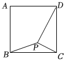
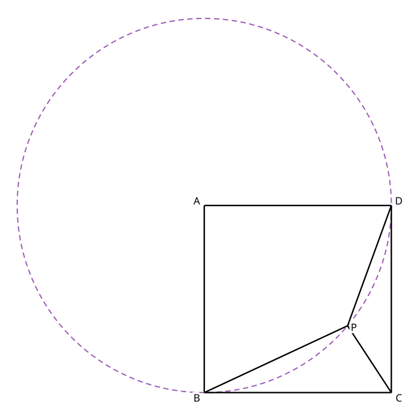

1. （2023秋•太和县期末）如图，$P$ 是边长为 1 的正方形 $ABCD$ 内的一个动点，且满足 $\angle PBC+\angle PDC=45^\circ$，则 $CP$ 的最小值是（　　）

A. $2-\sqrt{2}$

B. $\frac{1}{2}$

C. $\frac{\sqrt{2}}{2}$

D. $\sqrt{2}-1$

> [!question]- 点击查看答案与解析
> 【答案】D，$\sqrt{2}-1$
> 
> 【考点】定弦定角隐圆、正方形性质、点圆距离最值 → [[【初中数学知识点体系-人教版】#29-1 圆的基本性质]]、特殊的平行四边形 → [[【初中数学知识点体系-人教版】#21-2 特殊的平行四边形]]
> 
> 【解析】
> 正方形中 $\angle BCD=90^\circ$。在 $\triangle PBC$、$\triangle PDC$ 中分别用内角和，$\angle BPC+\angle DPC=360^\circ-(\angle PBC+\angle PDC)-(\angle PCB+\angle PCD)=360^\circ-45^\circ-90^\circ=225^\circ$，故内部 $\angle BPD=360^\circ-225^\circ=135^\circ$。
> 弦 $BD$ 固定，所对圆周角 $\angle BPD=135^\circ$ 为定值；又 $AB=AD=1$，以 $A$ 为圆心、$1$ 为半径作圆，$B$、$D$ 在圆上，优弧 $BD$ 上的点对 $BD$ 的圆周角恰为 $(360^\circ-90^\circ)/2=135^\circ$，故 $P$ 在该圆的弧 $BD$ 上。
> 对角线 $AC=\sqrt{2}$，$AP=1$；$CP$ 最小时 $P$ 落在线段 $AC$ 上，$CP_{\min}=CA-AP=\sqrt{2}-1$，选 D。
> 
> 
> 【易错点】由内角和求出的是优角 $225^\circ$，内部 $\angle BPD$ 要取 $360^\circ-225^\circ=135^\circ$；$135^\circ$ 圆周角对应优弧，圆心角为 $90^\circ$，隐圆圆心是 $A$，不是 $BD$ 中点。