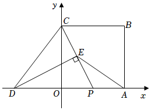
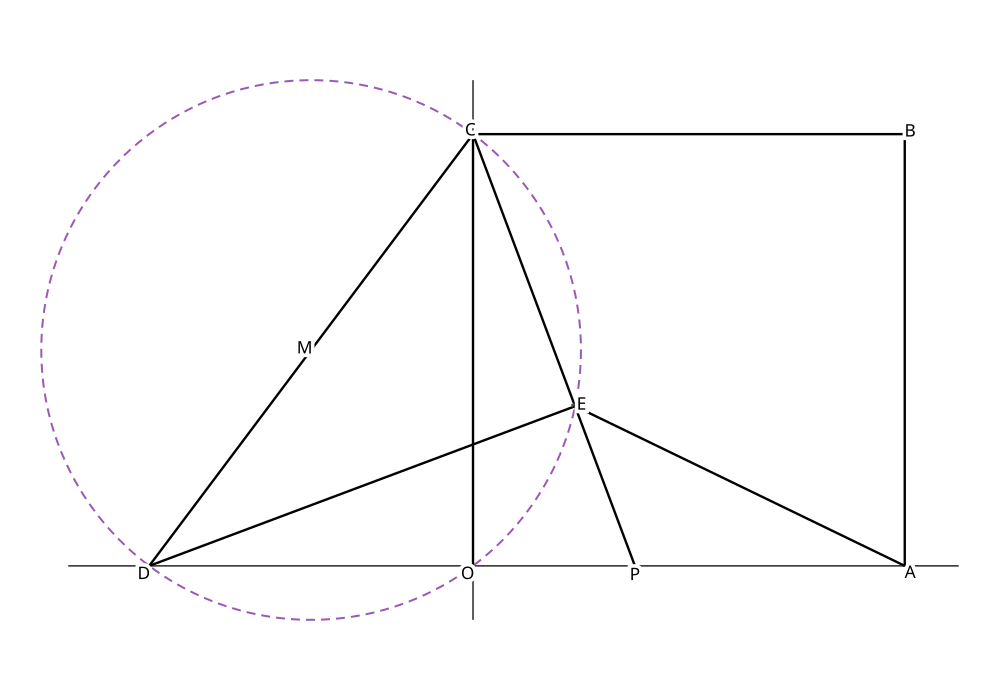

2. （2022•睢阳区校级模拟）如图，正方形 $OABC$ 中，$A$（8，0），$B$（8，8），点 $D$ 坐标为（-6，0），连接 $CD$，点 $P$ 为边 $OA$ 上一个动点，连接 $CP$，过点 $D$ 作 $DE\perp CP$ 于点 $E$，连接 $AE$，当 $AE$ 取最小值时，点 $E$ 的纵坐标为（　　）

A. $3-\frac{15}{89}\sqrt{89}$

B. $4-\frac{20}{137}\sqrt{137}$

C. $\frac{11}{3}$

D. $\frac{15}{4}$

> [!question]- 点击查看答案与解析
> 【答案】B，$4-\frac{20}{137}\sqrt{137}$
> 
> 【考点】直角对直径隐圆、点圆距离最值、坐标法与勾股定理 → [[【初中数学知识点体系-人教版】#29-1 圆的基本性质]]、坐标方法的简单应用 → [[【初中数学知识点体系-人教版】#9-2 坐标方法的简单应用]]、勾股定理 → [[【初中数学知识点体系-人教版】#20-1 勾股定理]]
> 
> 【解析】
> $DE\perp CP$，$\angle DEC=90^\circ$，定边 $CD$ 固定，故 $E$ 在以 $CD$ 为直径的圆上。
> 建系 $O(0,0)$、$A(8,0)$、$B(8,8)$、$C(0,8)$、$D(-6,0)$，圆心 $M$ 为 $CD$ 中点，$M(-3,4)$，$CD=10$，半径 $r=5$。
> $AE$ 最小时 $E$ 在线段 $AM$ 上，$AM=\sqrt{(8+3)^2+(0-4)^2}=\sqrt{137}$。$E=M+\frac{5}{\sqrt{137}}(A-M)$，其纵坐标 $y_E=4+\frac{5}{\sqrt{137}}(0-4)=4-\frac{20}{\sqrt{137}}=4-\frac{20}{137}\sqrt{137}$，选 B。
> 
> 
> 【易错点】直角顶点 $E$ 对定边 $CD$，隐圆直径是 $CD$；最近点在射线 $MA$ 与圆的交点上，纵坐标由定比分点求出，不要直接取圆上最低点。