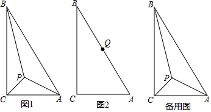
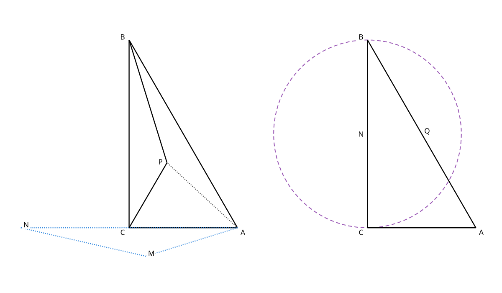

3. （2018•包河区一模）如图，在 $\triangle ABC$ 中，$\angle ACB=90^\circ$，$\angle BAC=60^\circ$，$AC=2$，$P$ 为 $\triangle ABC$ 所在平面内一点，分别连接 $PA$，$PB$，$PC$．

（1）如图1，已知：$\angle APB=\angle BPC=\angle APC$，以点 $A$ 为旋转中心，将 $\triangle APB$ 顺时针旋转 60 度，得到 $\triangle AMN$；

$①$ 请画出图形，并求证：$C$、$P$、$M$、$N$ 四点在同一条直线上；

$②$ 求 $PA+PB+PC$ 的值．

（2）如图2，如果点 $P$ 满足 $\angle BPC=90^\circ$，设 $Q$ 是 $AB$ 边中点，求 $PQ$ 长的取值范围．

> [!question]- 点击查看答案与解析
> 【答案】（1）①见解析；②$PA+PB+PC=2\sqrt{7}$；（2）$\sqrt{3}-1\le PQ\le\sqrt{3}+1$
> 
> 【考点】旋转全等、直角对直径隐圆、三角形中位线 → [[【初中数学知识点体系-人教版】#28-1 图形的旋转]]、三角形全等的判定 → [[【初中数学知识点体系-人教版】#14-2 三角形全等的判定]]、圆的基本性质 → [[【初中数学知识点体系-人教版】#29-1 圆的基本性质]]、与三角形有关的线段 → [[【初中数学知识点体系-人教版】#13-2 与三角形有关的线段]]
> 
> 【解析】
> （1）① 旋转后 $AP=AM$，$\angle PAM=60^\circ$，$\triangle APM$ 为等边三角形，$PM=AP$，$\angle APM=\angle AMP=60^\circ$。由旋转 $\angle AMN=\angle APB=120^\circ$，又 $\angle BPC=\angle APC=120^\circ$，故 $\angle CPM=\angle APC+\angle APM=180^\circ$，$\angle AMN+\angle AMP=180^\circ$，$C$、$P$、$M$、$N$ 四点共线。
> ② $PA+PB+PC=PM+MN+PC=CN$。$AN=AB=4$，$\angle CAN=\angle CAB+\angle BAN=60^\circ+60^\circ=120^\circ$。在 $\triangle ACN$ 中，$CN^2=AC^2+AN^2-2\cdot AC\cdot AN\cdot\cos120^\circ=4+16+8=28$，$CN=2\sqrt{7}$。
> （2）$\angle BPC=90^\circ$，$P$ 在以 $BC$ 为直径的圆上。$\angle BAC=60^\circ$，$AC=2$，$BC=2\sqrt{3}$，圆心为 $BC$ 中点 $N$，半径 $\sqrt{3}$。建系 $C(0,0)$、$A(2,0)$、$B(0,2\sqrt{3})$，$Q$ 为 $AB$ 中点，$Q(1,\sqrt{3})$，$N(0,\sqrt{3})$，$NQ=1$，故 $\sqrt{3}-1\le PQ\le\sqrt{3}+1$。
> 
> 
> 【易错点】共线证明要分别用平角（$180^\circ$）在 $P$ 点和 $M$ 点两处说清；(2) 中 $P$ 在圆上，$PQ$ 的最值是圆心距 $NQ$ 加减半径，不要把 $Q$ 当作圆心。