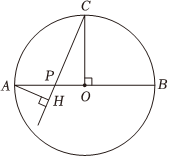
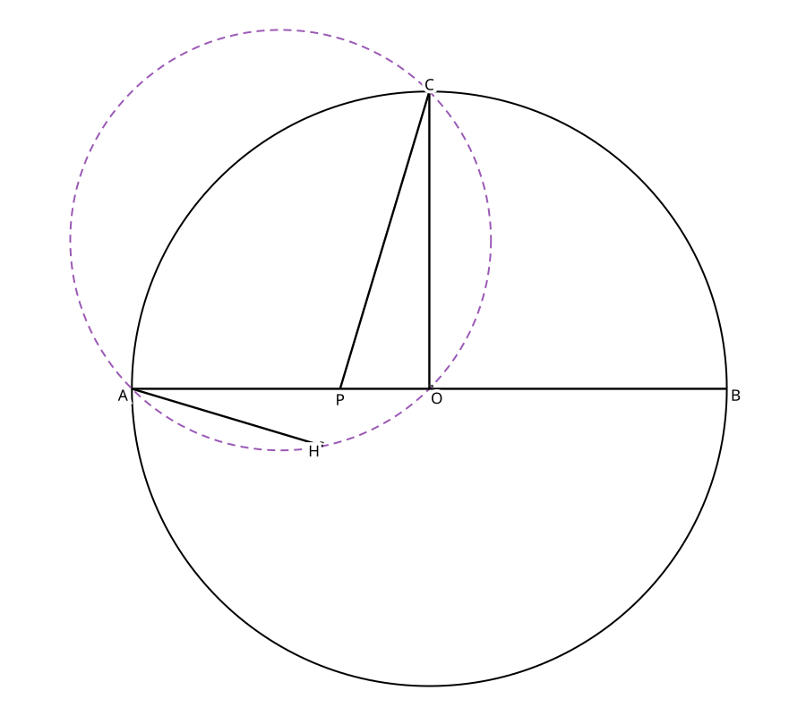

4. （2024秋•通州区期中）如图，$\odot O$ 的直径 $AB$ 为 8，$P$ 是 $AB$ 上一动点，半径 $OC$ 垂直于 $AB$，$AH\perp CP$，垂足为 $H$．当点 $P$ 从 $A$ 运动到 $B$ 的过程中，点 $H$ 运动的路径长为（　　）

A. $2\pi$

B. $2\sqrt{2}\pi$

C. $4\pi$

D. $4\sqrt{2}\pi$

> [!question]- 点击查看答案与解析
> 【答案】B，$2\sqrt{2}\pi$
> 
> 【考点】直角对直径隐圆、轨迹弧长 → [[【初中数学知识点体系-人教版】#29-1 圆的基本性质]]、弧长和扇形面积 → [[【初中数学知识点体系-人教版】#30-3 弧长和扇形面积]]
> 
> 【解析】
> $AH\perp CP$，$\angle AHC=90^\circ$，定边 $AC$ 固定，故 $H$ 在以 $AC$ 为直径的圆上。
> $OA=OC=4$，$OC\perp AB$，$AC=\sqrt{4^2+4^2}=4\sqrt{2}$，轨迹圆半径 $r=2\sqrt{2}$。
> $P$ 从 $A$ 运动到 $B$ 时，$H$ 从 $A$ 沿该圆运动到 $C$，走过一段半圆弧，路径长 $\pi r=2\sqrt{2}\pi$，选 B。
> 
> 
> 【易错点】垂足 $H$ 的直角对定边 $AC$，隐圆直径是 $AC$；$P$ 走满整条直径 $AB$ 时 $H$ 走半圆而非整圆，弧长不要乘 $2$。