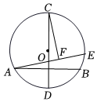
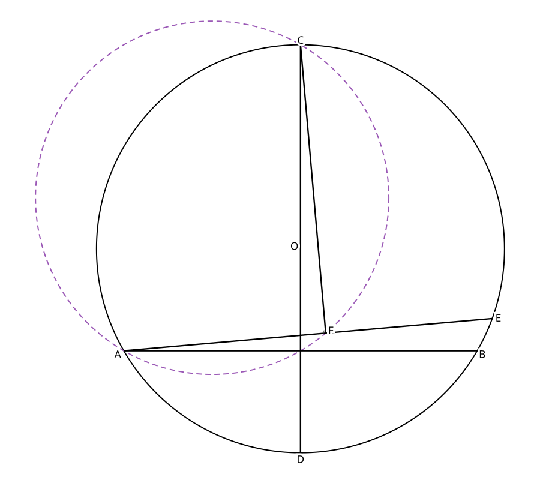

5. （2026•海门区校级模拟）如图，半径为 4 的 $\odot O$ 中，$CD$ 为直径，弦 $AB\perp CD$ 且过半径 $OD$ 的中点，点 $E$ 为 $\odot O$ 上一动点，$CF\perp AE$ 于点 $F$．当点 $E$ 从点 $B$ 出发顺时针运动到点 $D$ 时，点 $F$ 所经过的路径长为 ___ ．

> [!question]- 点击查看答案与解析
> 【答案】$\frac{2\sqrt{3}\pi}{3}$
> 
> 【考点】直角对直径隐圆、轨迹弧长 → [[【初中数学知识点体系-人教版】#29-1 圆的基本性质]]、弧长和扇形面积 → [[【初中数学知识点体系-人教版】#30-3 弧长和扇形面积]]
> 
> 【解析】
> $CF\perp AE$，$\angle AFC=90^\circ$，定边 $AC$ 固定，故 $F$ 在以 $AC$ 为直径的圆上。
> 半径为 $4$，$AB\perp CD$ 且过 $OD$ 中点，弦 $AB$ 到 $O$ 的距离为 $2$。取 $C(0,4)$、$O(0,0)$，则 $A(-2\sqrt{3},-2)$，$AC=\sqrt{(2\sqrt{3})^2+6^2}=4\sqrt{3}$，轨迹圆半径 $2\sqrt{3}$。
> $E=B$ 时 $F=(0,-2)$；$E=D$ 时 $AD\perp AC$，垂足 $F=A$。两位置在轨迹圆上所对圆心角为 $60^\circ$，弧长 $=\frac{60^\circ}{180^\circ}\pi\cdot 2\sqrt{3}=\frac{2\sqrt{3}\pi}{3}$。
> 
> 
> 【易错点】先由弦心距 $2$ 求出半弦长 $2\sqrt{3}$；轨迹是一段 $60^\circ$ 弧而非整圆，端点要按 $E$ 的两个临界位置分别确定。