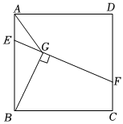
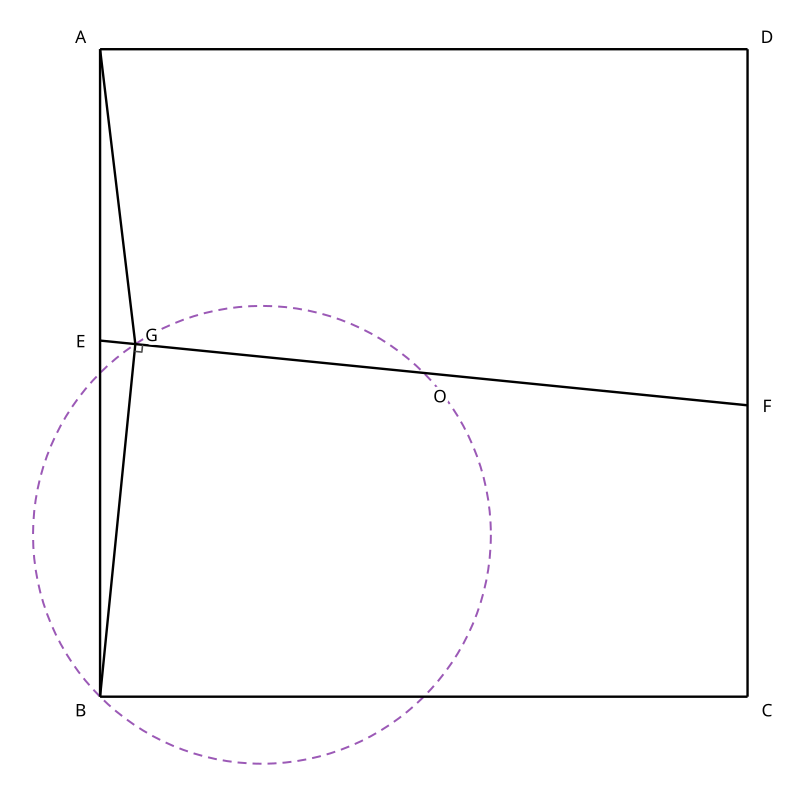

6. 如图，正方形 $ABCD$ 的边长为 4，$E$ 是边 $AB$ 上一个动点，$F$ 是边 $CD$ 上一个动点，且 $AE=CF$，连接 $EF$，过点 $B$ 作 $BG\perp EF$ 于点 $G$，连接 $AG$，则 $AG$ 长的最小值为 ___ ．

> [!question]- 点击查看答案与解析
> 【答案】$\sqrt{10}-\sqrt{2}$
> 
> 【考点】正方形性质、直角对直径隐圆、点圆距离最值 → [[【初中数学知识点体系-人教版】#21-2 特殊的平行四边形]]、圆的基本性质 → [[【初中数学知识点体系-人教版】#29-1 圆的基本性质]]、勾股定理 → [[【初中数学知识点体系-人教版】#20-1 勾股定理]]
> 
> 【解析】
> 设 $AE=CF=t$，由坐标（或全等）可证直线 $EF$ 恒过正方形中心 $O(2,2)$。
> $BG\perp EF$，故 $\angle BGO=90^\circ$，定边 $BO$ 固定，$G$ 在以 $BO$ 为直径的圆上，圆心为 $BO$ 中点 $(1,1)$，半径 $r=\sqrt{2}$。
> $A(0,4)$，圆心距 $\sqrt{(1-0)^2+(1-4)^2}=\sqrt{10}$，$AG_{\min}=\sqrt{10}-\sqrt{2}$。
> 
> 
> 【易错点】先证明 $EF$ 过中心 $O$，$\angle BGO$ 才是定直角；隐圆直径是 $BO$，最小值为圆心距减半径。