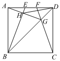
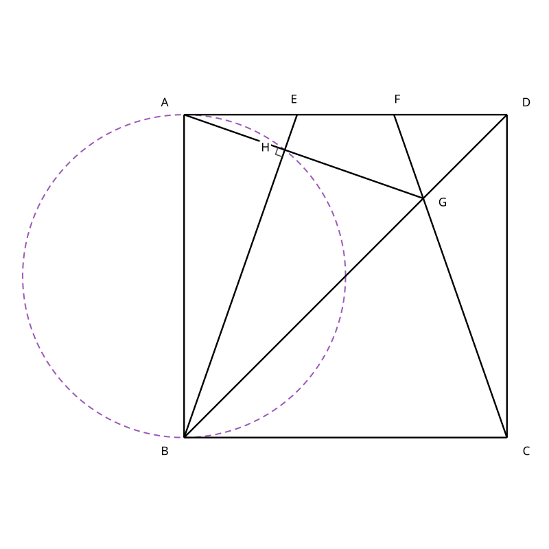

7. （2026春•长武县校级期末）如图，$E$，$F$ 是正方形 $ABCD$ 的边 $AD$ 上两个动点，满足 $AE=DF$．连接 $CF$ 交 $BD$ 于点 $G$，连接 $BE$ 交 $AG$ 于点 $H$．若正方形的边长为 2，则线段 $DH$ 长度的最小值是（　　）

A. $\frac{\sqrt{5}-1}{2}$

B. $\frac{1-\sqrt{5}}{2}$

C. $\sqrt{5}-1$

D. $1-\sqrt{5}$

> [!question]- 点击查看答案与解析
> 【答案】C，$\sqrt{5}-1$
> 
> 【考点】全等证垂直、直角对直径隐圆、点圆距离最值 → [[【初中数学知识点体系-人教版】#14-2 三角形全等的判定]]、特殊的平行四边形 → [[【初中数学知识点体系-人教版】#21-2 特殊的平行四边形]]、圆的基本性质 → [[【初中数学知识点体系-人教版】#29-1 圆的基本性质]]
> 
> 【解析】
> $AE=DF$，$AB=DA$，$\angle BAE=\angle ADF=90^\circ$，故 $\triangle ABE\cong\triangle DAF$（SAS），$\angle ABE=\angle DAF$。结合 $BD$ 为正方形对角线的对称性，可证 $AG\perp BE$，即 $\angle AHB=90^\circ$。
> 定边 $AB$ 固定，$H$ 在以 $AB$ 为直径的圆上，圆心为 $AB$ 中点 $(0,1)$，半径 $1$。
> $D(2,2)$ 到圆心距离 $\sqrt{2^2+1^2}=\sqrt{5}$，$DH_{\min}=\sqrt{5}-1$，选 C。
> 
> 
> 【易错点】先由全等推出 $AG\perp BE$，直角顶点 $H$ 才落在以 $AB$ 为直径的圆上；选项 B、D 为负值，线段长度不可能为负。