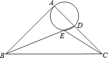
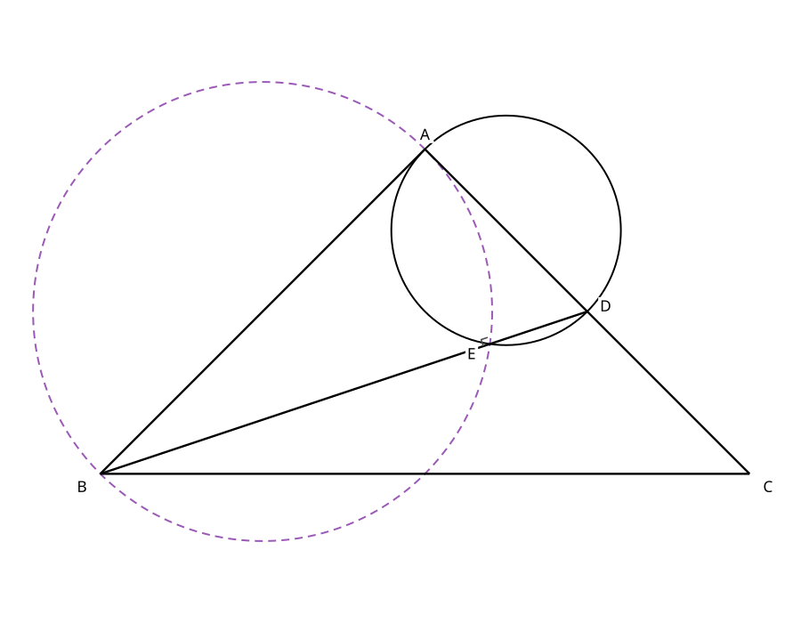

8. （2021•东安县一模）如图，在等腰 Rt$\triangle ABC$ 中，$\angle BAC=90^\circ$，$AB=AC$，$BC=3\sqrt{2}$，点 $D$ 是 $AC$ 边上一动点，连接 $BD$，以 $AD$ 为直径的圆交 $BD$ 于点 $E$，则线段 $CE$ 长度的最小值为 ___ ．

> [!question]- 点击查看答案与解析
> 【答案】$\frac{3\sqrt{5}-3}{2}$
> 
> 【考点】直角对直径隐圆、点圆距离最值、勾股定理 → [[【初中数学知识点体系-人教版】#29-1 圆的基本性质]]、勾股定理 → [[【初中数学知识点体系-人教版】#20-1 勾股定理]]
> 
> 【解析】
> $AD$ 为直径，$E$ 在圆上，故 $\angle AED=90^\circ$，即 $AE\perp BD$，从而 $\angle AEB=90^\circ$。定边 $AB$ 固定，$E$ 在以 $AB$ 为直径的圆上。
> 等腰 $\mathrm{Rt}\triangle ABC$ 中 $BC=3\sqrt{2}$，故 $AB=AC=3$，轨迹圆半径 $\frac{3}{2}$，圆心为 $AB$ 中点。
> 建系 $B(0,0)$、$C(3\sqrt2,0)$、$A(\frac{3\sqrt2}{2},\frac{3\sqrt2}{2})$，圆心 $O_1$ 为 $AB$ 中点 $(\frac{3\sqrt2}{4},\frac{3\sqrt2}{4})$，$O_1C=\frac{3\sqrt5}{2}$，$CE_{\min}=\frac{3\sqrt5}{2}-\frac{3}{2}=\frac{3\sqrt5-3}{2}$。
> 
> 
> 【易错点】直径 $AD$ 上的圆周角 $\angle AED=90^\circ$，推出 $\angle AEB=90^\circ$ 后隐圆直径转为 $AB$；最小值为圆心距减半径。