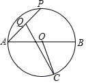
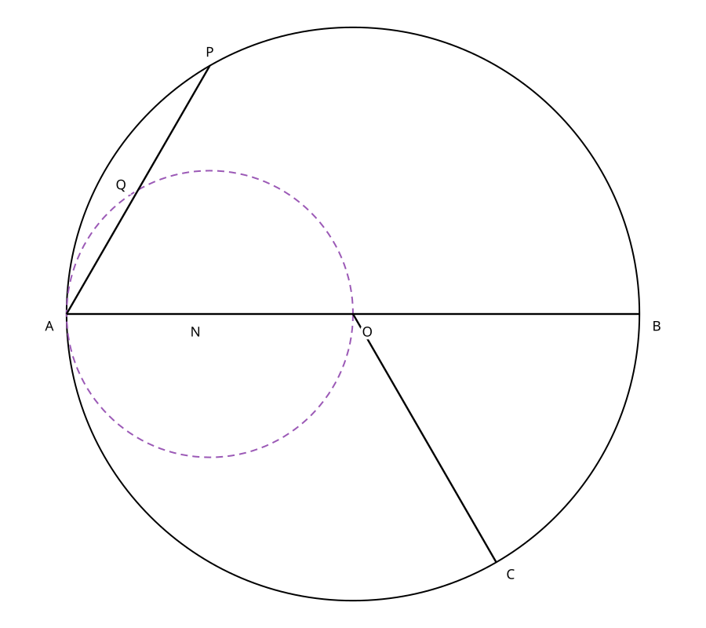

9. （2019•高青县一模）如图，$AB$ 为 $\odot O$ 的直径，$C$ 为 $\odot O$ 上一点，其中 $AB=4$，$\angle AOC=120^\circ$，$P$ 为 $\odot O$ 上的动点，连接 $AP$，取 $AP$ 中点 $Q$，连接 $CQ$，则线段 $CQ$ 的最大值为（　　）

A. 3

B. $1+\sqrt{6}$

C. $1+3\sqrt{2}$

D. $1+\sqrt{7}$

> [!question]- 点击查看答案与解析
> 【答案】D，$1+\sqrt{7}$
> 
> 【考点】三角形中位线定长隐圆、点圆距离最值 → [[【初中数学知识点体系-人教版】#13-2 与三角形有关的线段]]、圆的基本性质 → [[【初中数学知识点体系-人教版】#29-1 圆的基本性质]]
> 
> 【解析】
> $Q$ 为 $AP$ 中点，取 $AO$ 中点 $N$，$NQ$ 为 $\triangle AOP$ 的中位线，$NQ=\frac{OP}{2}=1$，$Q$ 在以 $N$ 为圆心、$1$ 为半径的圆上。
> $AB=4$，$OP=OA=2$。建系 $O(0,0)$、$A(-2,0)$，$N(-1,0)$；$\angle AOC=120^\circ$，$C(1,-\sqrt{3})$。
> $CN=\sqrt{(1+1)^2+(-\sqrt{3})^2}=\sqrt{7}$，$CQ_{\max}=CN+1=\sqrt{7}+1$，选 D。
> 
> 
> 【易错点】中位线把动点 $Q$ 到定点 $N$ 的距离定长为半径（$OP/2$）；最大值为圆心距加半径。