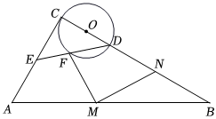
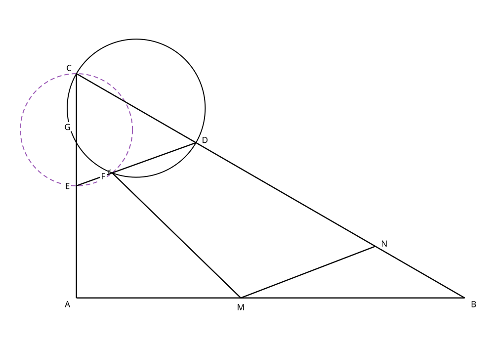

10. （2023秋•广汉市校级月考）如图，$\triangle ABC$ 中，$\angle ACB=90^\circ$，$\angle B=30^\circ$，$AC=3$，$E$ 是 $AC$ 的中点，$M$、$N$ 分别是边 $AB$、$BC$ 上的动点，$D$ 也是 $BC$ 边上的一个动点，以 $CD$ 为直径作 $\odot O$，连接 $ED$ 交 $\odot O$ 于 $F$，连接 $FM$，$MN$，则 $FM+MN$ 的最小值为 ___ ．

> [!question]- 点击查看答案与解析
> 【答案】$\frac{27}{8}$
> 
> 【考点】直角对直径隐圆、轴对称最短路径、垂线段最短 → [[【初中数学知识点体系-人教版】#29-1 圆的基本性质]]、图形的轴对称 → [[【初中数学知识点体系-人教版】#15-1 图形的轴对称]]
> 
> 【解析】
> $CD$ 为 $\odot O$ 直径，故 $\angle CFD=90^\circ$；$E$、$D$、$F$ 共线，$\angle CFE=90^\circ$。取 $CE$ 中点 $G$，$F$ 在以 $G$ 为圆心、$\frac{CE}{2}$ 为半径的圆上，$GF=\frac{3}{4}$。
> 将 $\triangle ABC$ 沿 $AB$ 翻折，$N$ 的对称点 $N'$ 在 $BC'$ 上，由轴对称 $MN=MN'$，于是 $FM+MN=FM+MN'$。
> 建系 $C(0,0)$、$B(3\sqrt{3},0)$、$A(0,3)$，$E$ 为 $AC$ 中点，$G(0,\frac{3}{4})$。翻折后射线 $BC'$ 与 $BC$ 夹角 $60^\circ$，方向向量 $(-\frac12,\frac{\sqrt3}{2})$；由点到直线距离公式，$G$ 到 $BC'$ 的距离为 $\frac{33}{8}$。
> 由垂线段最短，$FM+MN'\ge\frac{33}{8}$，再减去半径 $GF=\frac{3}{4}$，$FM+MN_{\min}=\frac{33}{8}-\frac{3}{4}=\frac{27}{8}$。
> 
> 
> 【易错点】翻折把 $MN$ 换到另一侧的 $MN'$，先连成折线段再用垂线段最短；最后别漏减轨迹圆半径 $GF$。