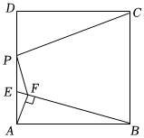
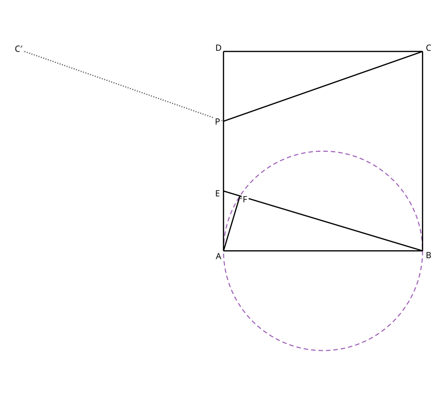

11. （2025•武汉模拟）如图，正方形 $ABCD$ 的边长是 4，点 $E$ 是 $AD$ 边上一动点，连接 $BE$，过点 $A$ 作 $AF\perp BE$ 于点 $F$，点 $P$ 是 $AD$ 边上另一动点，则 $PC+PF$ 的最小值为 ___ ．

> [!question]- 点击查看答案与解析
> 【答案】$2\sqrt{13}-2$
> 
> 【考点】直角对直径隐圆、轴对称最短路径、正方形性质 → [[【初中数学知识点体系-人教版】#29-1 圆的基本性质]]、图形的轴对称 → [[【初中数学知识点体系-人教版】#15-1 图形的轴对称]]、特殊的平行四边形 → [[【初中数学知识点体系-人教版】#21-2 特殊的平行四边形]]
> 
> 【解析】
> $AF\perp BE$，$\angle AFB=90^\circ$，定边 $AB$ 固定，$F$ 在以 $AB$ 为直径的圆上，半径 $2$。
> 建系 $A(0,0)$、$B(4,0)$、$C(4,4)$、$D(0,4)$。$P$ 在 $AD$ 上，作 $C$ 关于 $AD$ 的对称点 $C'(-4,4)$，则 $PC=PC'$，$PC+PF=PC'+PF\ge FC'$。
> 圆心 $(2,0)$，$C'$ 到圆心距离 $\sqrt{(2+4)^2+(0-4)^2}=2\sqrt{13}$，$FC'_{\min}=2\sqrt{13}-2$。
> 
> 
> 【易错点】将军饮马先把 $PC$ 对称到 $PC'$，再用圆外一点到圆上的最短距离；$F$ 的轨迹圆直径是 $AB$，半径为边长一半。