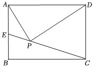
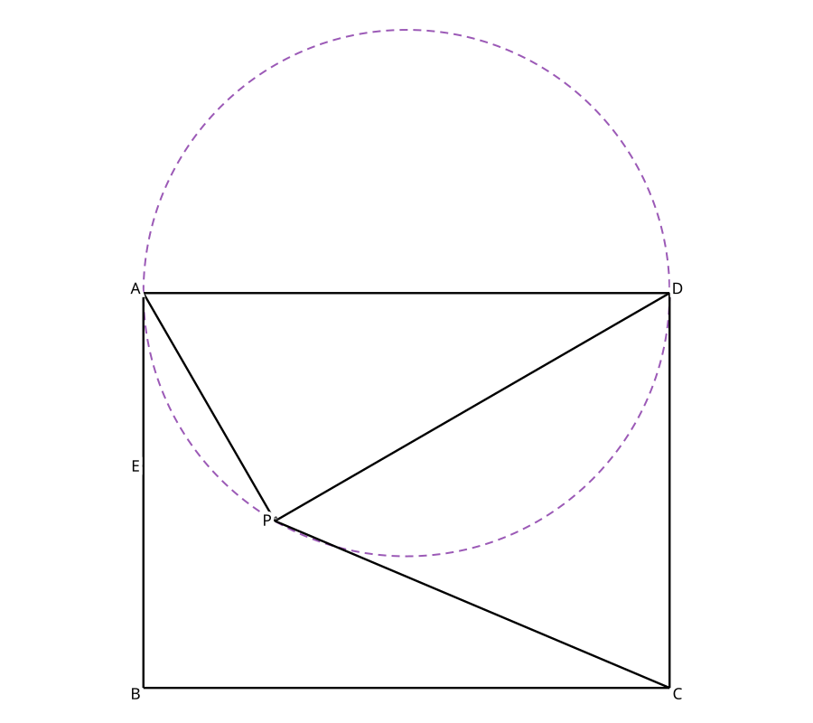

12. （2023秋•建邺区校级月考）如图，在矩形 $ABCD$ 中，$AB=6$，$AD=8$，$P$ 是矩形内部的一个动点，且 $\angle APD=90^\circ$，连接 $CP$ 并延长交 $AB$ 于 $E$，则 $AE$ 的最大值为 ___ ．

> [!question]- 点击查看答案与解析
> 【答案】$\frac{8}{3}$
> 
> 【考点】直角对直径隐圆、切线长定理、勾股定理 → [[【初中数学知识点体系-人教版】#29-1 圆的基本性质]]、直线和圆的位置关系 → [[【初中数学知识点体系-人教版】#30-1 直线和圆的位置关系]]、勾股定理 → [[【初中数学知识点体系-人教版】#20-1 勾股定理]]
> 
> 【解析】
> $\angle APD=90^\circ$，定边 $AD$ 固定，$P$ 在以 $AD$ 为直径的圆上。
> 当直线 $CE$ 与该圆相切时，$E$ 的位置最靠 $A$，$AE$ 最大。由切线长定理：从 $C$ 引圆的两条切线 $CP$、$CD$，$CP=CD=AB=6$；从 $E$ 引两条切线 $EA$、$EP$，$EA=EP=x$。
> $BE=AB-AE=6-x$，$CE=CP+PE=6+x$。在 $\mathrm{Rt}\triangle BCE$ 中由勾股：$(6-x)^2+8^2=(6+x)^2$，解得 $x=\frac{8}{3}$，即 $AE_{\max}=\frac{8}{3}$。
> 
> 
> 【易错点】相切是 $AE$ 最大的临界位置；切线长成对相等，$CE=CP+PE$ 而非 $CP-PE$，勾股时直角边是 $BE$ 与 $BC$。