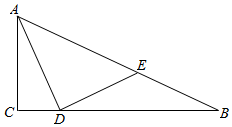
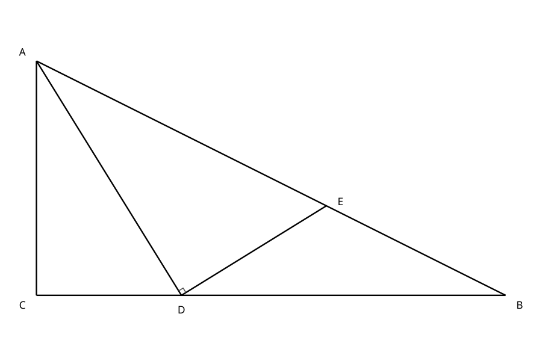

13. 如图，$\triangle ABC$ 中，$\angle C=90^\circ$，点 $D$ 为 $BC$ 边上一动点，$DE\perp AD$ 交 $AB$ 于 $E$，$AC=2$，$BC=4$，点 $D$ 在运动过程中，$BE$ 的最大值为 ___ ．

> [!question]- 点击查看答案与解析
> 【答案】$3\sqrt{5}-5$
> 
> 【考点】坐标法表示动点、垂直条件与线段最值、勾股定理 → [[【初中数学知识点体系-人教版】#9-2 坐标方法的简单应用]]、勾股定理 → [[【初中数学知识点体系-人教版】#20-1 勾股定理]]
> 
> 【解析】
> 建系 $C(0,0)$、$A(0,2)$、$B(4,0)$，设 $D(d,0)$，$E$ 在 $AB$ 上，记 $E=A+u(B-A)=(4u,2-2u)$。
> $DE\perp AD$，$(E-D)\cdot(A-D)=0$：$(4u-d,2-2u)\cdot(-d,2)=0$，解得 $u=\frac{d^2+4}{4(d+1)}$。
> $BE=(1-u)\cdot AB$，$AB=2\sqrt{5}$；要使 $BE$ 最大，只需 $u$ 最小。令 $t=d+1$（$t\in(1,5)$），则 $u=\frac{t^2-2t+5}{4t}=\frac14\left(t+\frac5t-2\right)$。由基本不等式 $t+\frac5t\ge 2\sqrt5$，等号在 $t=\sqrt5$ 时成立（在范围内），此时 $d=\sqrt5-1$，$u_{\min}=\frac{\sqrt5-1}{2}$。
> $BE_{\max}=\left(1-\frac{\sqrt5-1}{2}\right)\cdot 2\sqrt5=3\sqrt5-5$。
> 
> 
> 【易错点】$E$ 在斜边上，$BE$ 长度用参数 $u$ 按比例换算；最值点由 $u(d)$ 的最小值确定，$d$ 必须落在 $BC$ 线段范围内。