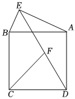
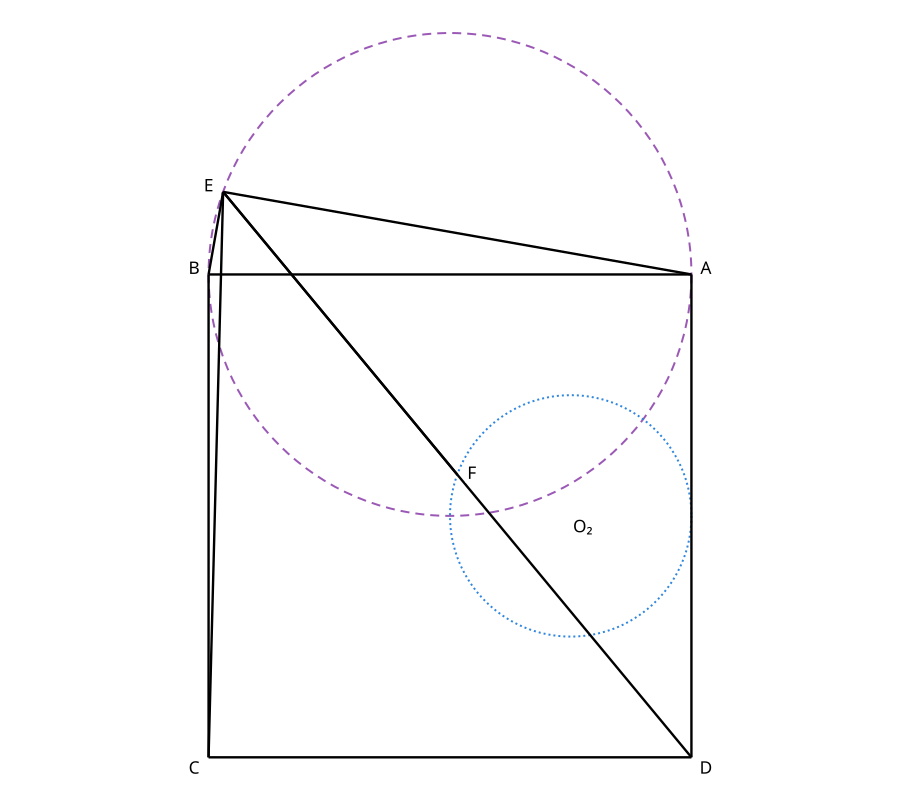

14. （2022秋•天门期中）如图，边长为 4 的正方形 $ABCD$ 外有一点 $E$，$\angle AEB=90^\circ$，$F$ 为 $DE$ 的中点，连接 $CF$，则 $CF$ 的最大值为 ___ ．

> [!question]- 点击查看答案与解析
> 【答案】$\sqrt{13}+1$
> 
> 【考点】中点轨迹（中位线平移）、直角对直径隐圆、点圆距离最值 → [[【初中数学知识点体系-人教版】#13-2 与三角形有关的线段]]、圆的基本性质 → [[【初中数学知识点体系-人教版】#29-1 圆的基本性质]]
> 
> 【解析】
> $\angle AEB=90^\circ$，定边 $AB$ 固定，$E$ 在以 $AB$ 为直径的圆上。
> $F$ 为 $DE$ 中点，取 $AB$ 中点 $O_1$、$D$ 与 $O_1$ 的中点 $O_2$，由中点平移（中位线），$F$ 的轨迹是以 $O_2$ 为圆心、半径 $1$ 的圆。
> 正方形边长 $4$，建系 $B(0,4)$、$A(4,4)$、$C(0,0)$、$D(4,0)$，$O_2=(3,2)$，$CO_2=\sqrt{3^2+2^2}=\sqrt{13}$，$CF_{\max}=\sqrt{13}+1$。
> 
> 
> 【易错点】中点轨迹是原隐圆按向量平移后的圆，半径减半；最大值为圆心距加半径。