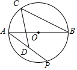
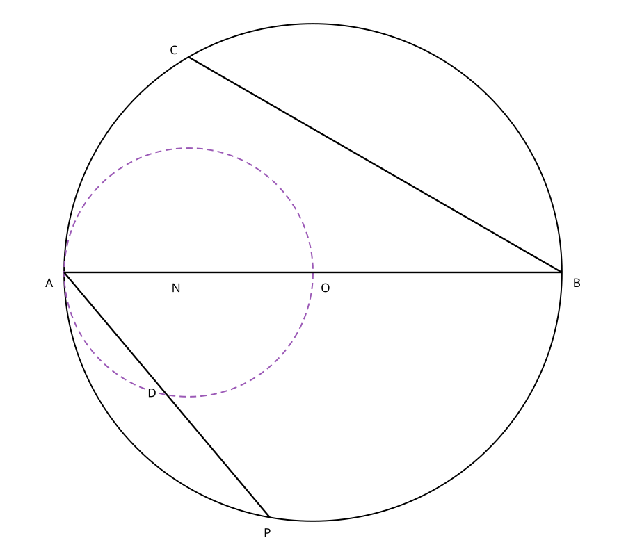

15. （2023•大庆模拟）如图，$AB$ 是 $\odot O$ 的直径，$AB=4$，$C$ 为 $\widehat{AB}$ 的三等分点（更靠近 $A$ 点），点 $P$ 是 $\odot O$ 上个动点，取弦 $AP$ 的中点 $D$，则线段 $CD$ 的最大值为（　　）

A. 2

B. $\sqrt{7}$

C. $2\sqrt{3}$

D. $\sqrt{3}+1$

> [!question]- 点击查看答案与解析
> 【答案】D，$\sqrt{3}+1$
> 
> 【考点】三角形中位线定长隐圆、点圆距离最值 → [[【初中数学知识点体系-人教版】#13-2 与三角形有关的线段]]、圆的基本性质 → [[【初中数学知识点体系-人教版】#29-1 圆的基本性质]]
> 
> 【解析】
> $D$ 为 $AP$ 中点，取 $AO$ 中点 $N$，$ND$ 为 $\triangle AOP$ 的中位线，$ND=\frac{OP}{2}=1$，$D$ 在以 $N$ 为圆心、$1$ 为半径的圆上。
> $AB=4$，建系 $A(-2,0)$、$B(2,0)$，$N(-1,0)$；$C$ 为靠近 $A$ 的三等分点，$\angle AOC=60^\circ$，$C(-1,\sqrt{3})$。
> $CN=\sqrt{3}$，$CD_{\max}=CN+1=\sqrt{3}+1$，选 D。
> 
> 
> 【易错点】中位线定长 $ND=$ 半径（$OP/2$）；$C$ 的位置由三等分点确定，别把圆心角取成 $120^\circ$。