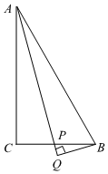
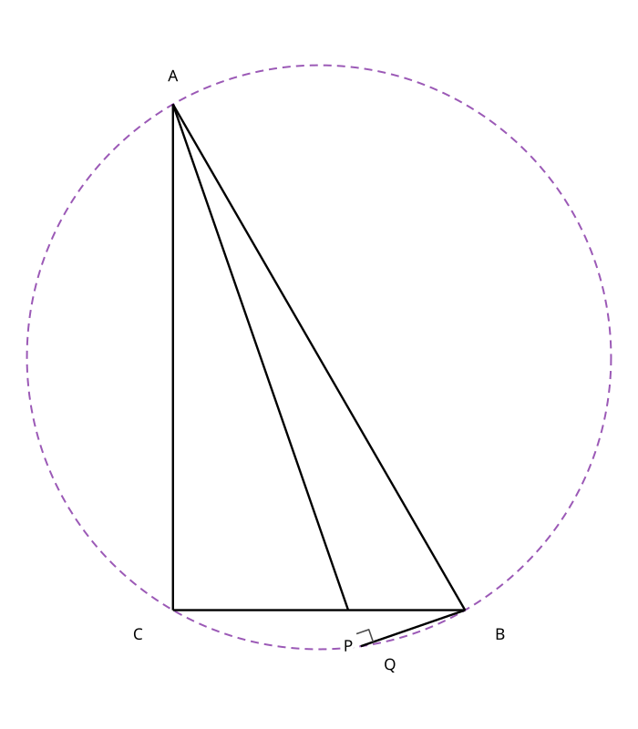

16. （2021秋•唐县期末）如图，$\triangle ABC$ 中，$\angle C=90^\circ$，$\angle BAC=30^\circ$，$AB=2$，点 $P$ 从 $C$ 点出发，沿 $CB$ 运动到点 $B$ 停止，过点 $B$ 作射线 $AP$ 的垂线，垂足为 $Q$，点 $Q$ 运动的路径长为（　　）

A. $\frac{2\sqrt{3}}{3}$

B. $\sqrt{3}$

C. $\frac{\sqrt{3}\pi}{6}$

D. $\frac{\pi}{3}$

> [!question]- 点击查看答案与解析
> 【答案】D，$\frac{\pi}{3}$
> 
> 【考点】直角对直径隐圆、轨迹弧长 → [[【初中数学知识点体系-人教版】#29-1 圆的基本性质]]、弧长和扇形面积 → [[【初中数学知识点体系-人教版】#30-3 弧长和扇形面积]]
> 
> 【解析】
> $BQ\perp AP$，$\angle AQB=90^\circ$，定边 $AB$ 固定，$Q$ 在以 $AB$ 为直径的圆上，半径 $1$。
> $\angle BAC=30^\circ$，$AB=2$；$P$ 从 $C$ 到 $B$，$Q$ 从 $C$ 运动到 $B$，轨迹为该圆上的弧 $CB$，所对圆心角为 $2\angle CAB=60^\circ$。
> 路径长 $=\frac{60^\circ}{180^\circ}\pi\cdot 1=\frac{\pi}{3}$，选 D。
> 
> 
> 【易错点】路径是一段圆弧，圆心角等于 $2$ 倍圆周角 $\angle BAC$；端点分别对应 $P=C$ 时 $Q=C$、$P=B$ 时 $Q=B$。