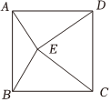
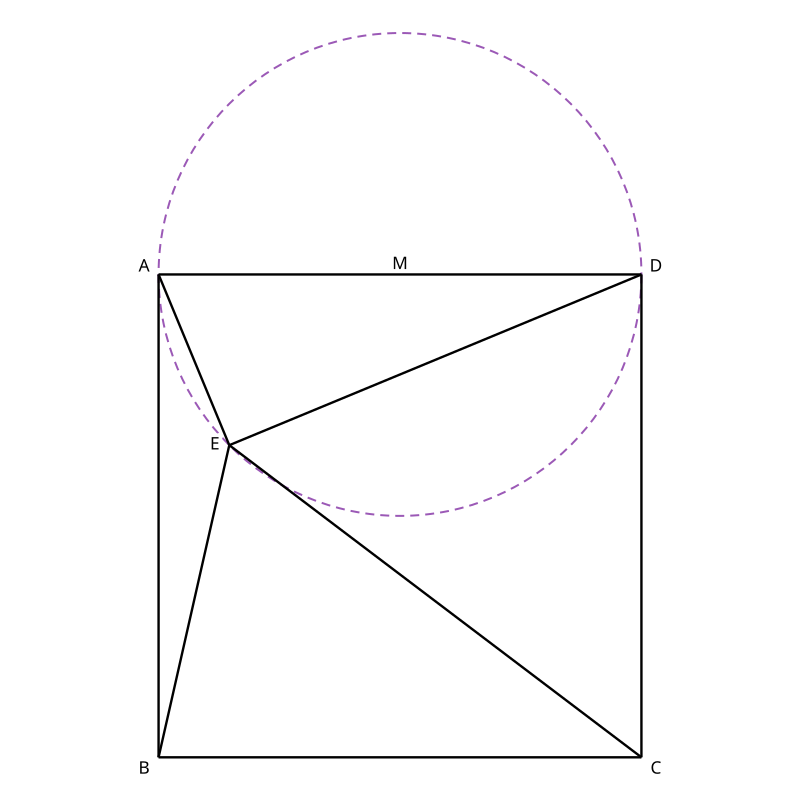

17. （2024秋•苏州期末）在正方形 $ABCD$ 中，$AB=AD=4$，$E$ 是平面内任意一点．若 $AE^{2}+DE^{2}=AD^{2}$，请写出线段 $BE$ 的最大值为 ___ ．

> [!question]- 点击查看答案与解析
> 【答案】$2\sqrt{5}+2$
> 
> 【考点】三角形中线定理、定长隐圆、点圆距离最值 → [[【初中数学知识点体系-人教版】#13-2 与三角形有关的线段]]、圆的基本性质 → [[【初中数学知识点体系-人教版】#29-1 圆的基本性质]]
> 
> 【解析】
> $M$ 为 $AD$ 中点，由三角形中线定理（阿波罗尼斯定理）：$AE^2+DE^2=2(AM^2+ME^2)$。
> $AE^2+DE^2=AD^2=16$，$AM=\frac{AD}{2}=2$，代入得 $16=2(4+ME^2)$，$ME=2$，$E$ 在以 $M$ 为圆心、$2$ 为半径的圆上。
> 正方形边长 $4$，建系 $A(0,4)$、$B(0,0)$、$D(4,4)$，$M(2,4)$，$BM=\sqrt{2^2+4^2}=2\sqrt{5}$，$BE_{\max}=2\sqrt{5}+2$。
> 
> 
> 【易错点】中线定理把平方和条件转化为定长 $ME$；最大值为圆心距加半径，$E$ 是平面内任意点，轨迹是整圆。