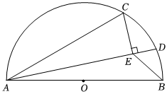
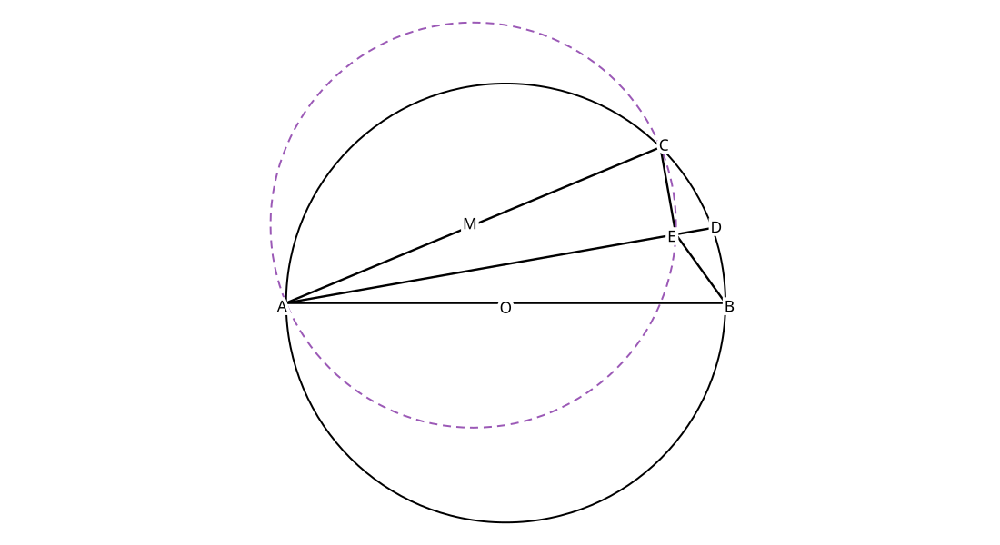

18. （2026秋•南湖区校级期中）如图，$AB$ 是半圆 $O$ 的直径，点 $C$ 在半圆 $O$ 上，$AB=13$，$AC=12$，$D$ 是弧 $\widehat{BC}$ 上的一个动点，连接 $AD$，过点 $C$ 作 $CE\perp AD$ 于点 $E$，连接 $BE$．在点 $D$ 移动的过程中，$BE$ 的最小值等于 ___ ．

> [!question]- 点击查看答案与解析
> 【答案】$\sqrt{61}-6$
> 
> 【考点】直角对直径隐圆、中线长与点圆距离最值、勾股定理 → [[【初中数学知识点体系-人教版】#29-1 圆的基本性质]]、勾股定理 → [[【初中数学知识点体系-人教版】#20-1 勾股定理]]
> 
> 【解析】
> $CE\perp AD$，$\angle AEC=90^\circ$，定边 $AC$ 固定，$E$ 在以 $AC$ 为直径的圆上，半径 $6$。
> $AB=13$，$AC=12$，由勾股 $BC=5$。$M$ 为 $AC$ 中点（轨迹圆圆心），$BM$ 是 $\triangle ABC$ 中 $AC$ 边上的中线。
> 由中线定理：$BM^2=\frac{2BA^2+2BC^2-AC^2}{4}=\frac{2\cdot169+2\cdot25-144}{4}=61$，$BM=\sqrt{61}$，$BE_{\min}=BM-6=\sqrt{61}-6$。
> 
> 
> 【易错点】隐圆直径是 $AC$，半径 $6$；最小值为圆心距减半径，中线长度用中线定理（或坐标）计算，不要误取 $B$ 到 $A$ 的距离。