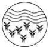
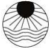
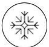

（3分）中国“二十四节气”已被列入联合国教科文组织人类非物质文化遗产代表作名录，下列四幅作品分别代表“立春”、“立夏”、“芒种”、“大雪”，其中不是轴对称图形的是（）

A. 

B. 

C. 

D. 

> [!question]- 点击查看答案与解析
> 【答案】A
> 
> 【考点】轴对称图形的判断 → [[【初中数学知识点体系-人教版】#15-1 图形的轴对称]]
> 
> 【解析】
> 判断轴对称图形的标准是：沿某条直线折叠后，直线两旁的部分能够互相重合。
> - A. 立春：两排燕子错位排列（上排与下排水平错开），波浪波峰不居中，找不到任何一条直线使折叠后两旁重合，不是轴对称图形，符合题意；
> - B. 立夏：太阳居中、光芒与波纹左右对称，有竖直对称轴，是轴对称图形；
> - C. 芒种：中间苗叶与下方两片叶子左右对称，有竖直对称轴，是轴对称图形；
> - D. 大雪：雪花四条主臂向外、四个斜箭头均指向中心，有竖直、水平（及对角）对称轴，是轴对称图形。
> 
> 验证（图像对称性自校验 4 项全部通过）：对四幅原卷图作左右镜像叠合比对（容差 1 像素），B、C、D 的镜像重合度均为 1.00（存在竖直对称轴），仅 A 为 0.70——燕子上下两排错位、波峰偏离中线破坏了对称性，故唯一不是轴对称图形的是 A。**修正说明**：原解析把 A 与 D 的判断恰好弄反——大雪雪花图案实际是轴对称图形，立春图才因燕子错位排列、波峰不居中而非轴对称；答案由 D 修正为 A。
> 
> 【易错点】注意轴对称图形和中心对称图形的区别，轴对称是沿直线翻折重合。
