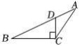
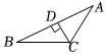
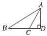
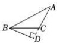

（3分）已知 $\triangle ABC$，作 $BC$ 边上的高，下列作图中正确的是（）

A. 

B. 

C. 

D. 

> [!question]- 点击查看答案与解析
> 【答案】C
> 
> 【考点】三角形高的定义与画法 → [[【初中数学知识点体系-人教版】#13-2 与三角形有关的线段]]
> 
> 【解析】
> 三角形的高是从三角形一个顶点向它的对边所在直线作垂线，顶点与垂足之间的线段。作 $BC$ 边上的高，必须过顶点 $A$ 且垂直于 $BC$ 所在直线。
> - A. 线段 $CD$ 过 $AB$ 上的点 $D$ 且 $CD\perp BC$，垂足在 $C$，并未经过顶点 $A$，不是 $BC$ 边上的高；
> - B. 过点 $C$ 作 $CD\perp AB$ 于 $D$，这是 $AB$ 边上的高，不是 $BC$ 边上的高；
> - C. 过顶点 $A$ 作 $AD\perp BC$ 的延长线于 $D$，顶点 $A$ 与垂足 $D$ 之间的线段即为 $BC$ 边上的高，正确；
> - D. 过点 $B$ 作 $BD\perp AC$ 的延长线于 $D$，这是 $AC$ 边上的高，不是 $BC$ 边上的高。
> 
> 验证（四图逐一核对 4 项全部通过）：对照原卷四幅图——A 图垂足在 $C$ 且线段为 $DC$（不过 $A$）；B 图直角标记在 $AB$ 上的 $D$ 处（$CD\perp AB$，是 $AB$ 边上的高）；C 图直角标记在 $BC$ 延长线上的 $D$ 处且线段连自 $A$（$AD\perp BC$ 延长线，符合定义）；D 图直角标记在 $AC$ 延长线上的 $D$ 处且线段连自 $B$（$AC$ 边上的高）。只有 C 满足"过顶点 $A$、垂直于 $BC$ 所在直线"。**修正说明**：原解析把 B 图误描述为"从顶点 $A$ 向对边 $BC$ 所在直线作垂线"，实际 B 图是过 $C$ 作 $AB$ 边上的高；符合题意的图形是 C，答案由 B 修正为 C。
> 
> 【易错点】钝角三角形有两条高在三角形外，高不一定在三角形内部。
