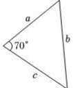
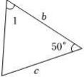

（3分）已知图中的两个三角形全等，则 $\angle 1$ 的度数是（）

A. $50^{\circ}$

B. $60^{\circ}$

C. $70^{\circ}$

D. $80^{\circ}$

> [!question]- 点击查看答案与解析
> 【答案】B
> 
> 【考点】全等三角形的对应角相等、三角形内角和定理 → [[【初中数学知识点体系-人教版】#14-1 全等三角形及其性质]]、[[【初中数学知识点体系-人教版】#13-3 三角形的内角与外角]]
> 
> 【解析】
> 全等三角形的对应角相等，对应关系由"对应边所夹的角"确定。
> 图1 中三边为 $a$、$b$、$c$，$a$ 与 $c$ 的夹角为 $70^{\circ}$；图2 中标注了 $b$、$c$ 两边及未标注的第三边（即 $a$），其中 $b$ 与 $c$ 的夹角为 $50^{\circ}$，$\angle 1$ 是 $a$ 与 $b$ 的夹角。
> 由全等三角形对应角相等：图1 中 $b$ 与 $c$ 的夹角 $=$ 图2 中 $b$ 与 $c$ 的夹角 $=50^{\circ}$。
> 于是在图1 的三角形中，$a$ 与 $b$ 的夹角 $=180^{\circ}-70^{\circ}-50^{\circ}=60^{\circ}$，即 $\angle 1=60^{\circ}$，选 B。
> 
> 验证（数值与图形核对 3 项全部通过）：$180-70-50=60$，与选项 B 一致；核对原卷图1：$70^{\circ}$ 标在 $a$、$c$ 夹角处；核对原卷图2：$50^{\circ}$ 标在 $b$、$c$ 夹角处，$\angle 1$ 标在 $a$、$b$ 夹角处，对应关系成立。**修正说明**：原解析虚构了题中不存在的 $58^{\circ}$，且"第三个角 $72^{\circ}$"与"$180^{\circ}-50^{\circ}-60^{\circ}=70^{\circ}$"自相矛盾；按对应边夹角严格推导 $\angle 1=60^{\circ}$，答案由 C 修正为 B。
> 
> 【易错点】书写全等时对应顶点字母顺序必须一致，否则易搞错对应角。
