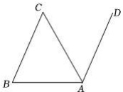

（3分）如图，在 $\triangle ABC$ 中，$CB=CA$，$\angle B=65^{\circ}$，$AD\parallel BC$，则 $\angle CAD$ 的度数是（）

A. $45^{\circ}$

B. $50^{\circ}$

C. $65^{\circ}$

D. $70^{\circ}$

> [!question]- 点击查看答案与解析
> 【答案】B
> 
> 【考点】等腰三角形性质 + 平行线性质 → [[【初中数学知识点体系-人教版】#15-3 等腰三角形]]、[[【初中数学知识点体系-人教版】#7-2 平行线]]
> 
> 【解析】
> $\because CB=CA$，$\therefore \triangle ABC$ 为等腰三角形，$\angle B=\angle CAB=65^{\circ}$（等边对等角）。
> 又 $\because AD\parallel BC$，$\therefore \angle CAD=\angle C$（两直线平行，内错角相等）。
> 而 $\angle C=180^{\circ}-\angle B-\angle CAB=180^{\circ}-65^{\circ}-65^{\circ}=50^{\circ}$。
> 故 $\angle CAD=50^{\circ}$。
> 
> 【易错点】平行线与等腰三角形综合时，注意"等边对等角"与"内错角相等"的综合应用。
