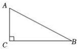

（3分）如图，在 $\triangle ABC$ 中，$\angle C=90^{\circ}$，$\angle B=30^{\circ}$，$AB=4$，则 $AC$ 的长度是（）

A. 3.5

B. 3

C. 2.5

D. 2

> [!question]- 点击查看答案与解析
> 【答案】D
> 
> 【考点】含 $30^{\circ}$ 角的直角三角形性质 → [[【初中数学知识点体系-人教版】#15-3 等腰三角形]]
> 
> 【解析】
> 在直角三角形中，若一个锐角为 $30^{\circ}$，则它所对的直角边等于斜边的一半。
> $\because \angle C=90^{\circ}$，$\angle B=30^{\circ}$，斜边 $AB=4$，$\therefore AC=\frac{1}{2}AB=\frac{1}{2}\times4=2$。
> 
> 【易错点】含 $30^{\circ}$ 角的结论只适用于直角三角形，且 $30^{\circ}$ 所对的直角边是斜边的一半。
